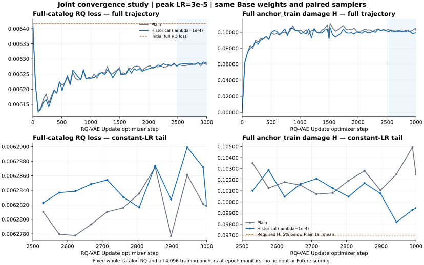

# History-aware SID Update Experiment Report

Last updated: 2026-10-28. The completed Llama content-RQ/TIGER results are retained below. The new SASRec CF-LETTER-adapted line has passed Base acceptance and the shared CF refresh diagnostic; the next three-arm codebook diagnostic is prepared for dispatch. No new codebook result, recommender Update fitting or Future evaluation is claimed.

## Primary downstream results

Future test, **full denominator: 34189 queries**. Recall is shown as a percentage; NDCG is shown in raw units.

| Tokenizer | TIGER state | Selected Update step | Recall@5 | Recall@10 | Recall@20 | NDCG@5 | NDCG@10 | NDCG@20 |
| --- | --- | ---: | ---: | ---: | ---: | ---: | ---: | ---: |
| Frozen Base RQ, extended catalog | Frozen Base TIGER | 0 | 0.476762% | 0.678581% | 0.933049% | 0.003373898224 | 0.004021264440 | 0.004668545582 |
| Plain RQ, 1000 Update steps | Frozen Base TIGER | 0 | 0.058498% | 0.099447% | 0.204744% | 0.000304899962 | 0.000440264698 | 0.000694146659 |
| Frozen Base RQ, extended catalog | Selected after Update fine-tuning | 500 | 0.699055% | 1.216766% | 1.813449% | 0.004427404386 | 0.006088073259 | 0.007579371337 |
| Plain RQ, 1000 Update steps | Selected after Update fine-tuning | 500 | 0.596683% | 0.979847% | 1.798824% | 0.003873351250 | 0.005105906826 | 0.007118554090 |
| Retuned History-aware RQ, 1000 Update steps | Frozen Base TIGER | 0 | 0.257393% | 0.321741% | 0.389014% | 0.001442893261 | 0.001653433621 | 0.001817588659 |
| Retuned History-aware RQ, 1000 Update steps | Selected after Update fine-tuning | 2000 | 0.778028% | 1.389336% | 2.152739% | 0.004622809742 | 0.006579084913 | 0.008508993425 |

All six conditions use the same 11775-item Update deployment catalog, beam=20, seen_item_filter=false, and invalid_predictions=0. The 6648 unavailable targets count as misses; coverage is 80.555149%. The Base control keeps Base RQ-VAE weights frozen and adds observed Update items; it is not the original Base deployment snapshot.

This is the main table previously located in Section 5.3. Maintain it here as completed downstream results become available. The two retuned History-aware Future conditions are now completed from the user-returned compact. “Selected Update step” is the checkpoint used for Future, not the training budget: all three fine-tuning arms trained 2000 steps; the original Base/Plain arms selected 500 and the History-aware arm selected 2000. The old Plain and retuned History-aware RQ recipes differ, so those rows do not isolate the historical penalty. Evaluation details, the servable-query table, and checkpoint selection are in [Section 5](#5-completed-baseplain-future-evaluation).

### Latest CF-LETTER-adapted Base validation

Job `cf-letter-base-001` passed the server scientific verifier. Full denominator: **9,192 Base validation queries**, including 503 unavailable targets as misses; 8,689 targets are servable (94.527850%). These are new Base recommendation results, not Future or frozen-teacher compatibility scores. Both models use the same Base catalog and raw 20-event histories.

| Model | Actual training steps | Selected step / epoch | Recall@5 | Recall@10 | Recall@20 | NDCG@5 | NDCG@10 | NDCG@20 |
| --- | ---: | ---: | ---: | ---: | ---: | ---: | ---: | ---: |
| SASRec CF source | 44,700 | 37,250 / 125 | 1.566580% | 2.991732% | 5.036989% | 0.008203680 | 0.012750642 | 0.017899974 |
| CF SID + GPT retriever | 8,940 | 1,192 / 4 | 1.958225% | 3.111401% | 4.862924% | 0.012056704 | 0.015726218 | 0.020088908 |

The CF quantizer completed 1,000 steps: hard reconstruction MSE=0.002218748, 53.30% below the mean-vector baseline. All three 512-entry books are used; 10,554 semantic codes cover 10,924 unique full SIDs, with a largest semantic bucket of 71 / suffix capacity 512. GPT trained for 30 epochs but the fixed validation probe selected epoch 4; the terminal checkpoint is not the deployed Base reference. See Section 6.23 for the curve analysis and evidence boundaries.

### Latest CF refresh diagnostic (training anchors only)

With the same frozen Base GPT and codebook weights, refreshing SASRec CF vectors
already changes old-item SIDs and increases historical prediction loss. These are
**4,096 anchor_train queries / 2,648 users**, using fixed old target/mask/catalog
and four-digit NLL without EOS; they are not new Base validation or Future scores.

| CF input to frozen quantizer | Anchor mean sequence NLL | Positive damage H | Old-item SID change | Old-item reconstruction MSE |
| --- | ---: | ---: | ---: | ---: |
| Original Base CF | 7.490371 | 0.000000 | 0.0000% | 0.002218748 |
| Refreshed CF, selected SASRec epoch 8 | 7.552976 | 0.102947 | 24.9359% | 0.002279873 |

Signed mean delta NLL is +0.062605 (95% training-user cluster bootstrap interval
[+0.052548, +0.073841]); H has interval [0.094070, 0.112839]. Of 10,924 old items,
2,724 change full SID. Maximum current bucket=53; required suffix capacity=72/512.
No quantizer or GPT training occurred, and no new-item serving SID was allocated.
This isolates damage from CF refresh/re-encoding in this run; it does not establish
historical-penalty benefit. The diagnostic is verified and stopped; see Section 6.25.

### Latest Base validation compatibility ranking

Completed paired run `llama_history_retuned_20261020T123132Z_Edpqdn`, confirmed by user-returned key fields: 1000 steps per arm and passed pair checks. Frozen Base TIGER, fixed old targets and Base train candidate addresses; full denominator=9192, with 8689 servable queries. These are compatibility metrics, **not Future results**.

| Condition | Recall@5 | Recall@10 | NDCG@5 | NDCG@10 |
| --- | ---: | ---: | ---: | ---: |
| Original Base reference | 1.294604% | 1.936466% | 0.008709150212 | 0.010793847025 |
| Retuned Plain | 1.196693% | 1.642733% | 0.007767552735 | 0.009225761662 |
| Retuned History-aware | 1.196693% | 1.718886% | 0.007927259322 | 0.009605876138 |

The returned Plain ranking entry now confirms the values previously derived from differences. History-aware gains +0.076153 percentage points in Recall@10 (+4.64% relative; 151 → 158 hits) and +0.000380114476 in NDCG@10 (+4.12% relative). Recall@5 is unchanged; both arms remain below the original Base reference. Final largest collision buckets are 30 / 32 for Plain / History-aware. However, History-aware worsens anchor_train H by 14.51% and anchor_holdout H by 10.57%; both paired H-difference 95% intervals are entirely positive. The modest ranking gain does not establish that the historical-damage objective succeeded. See Section 6.6. No ranking confidence intervals or statistical-significance claim are available.

This report records results returned from Hao's GPU server. The cloud workspace has no Beauty data or model checkpoints. Training and evaluation numbers come from returned compact reports and have not been independently recomputed in the cloud. Code delivery, local checks, and server execution are recorded separately. Earlier sentence-T5 results remain in the existing reports; they are not combined with this Llama pipeline as a controlled encoder ablation.

## 1. Latest status and conclusions

| Stage | Status | Available evidence |
| --- | --- | --- |
| Llama content features | Completed; server result returned | 4096 dimensions, float32; shared-item features unchanged |
| Base RQ-VAE | Completed; server result returned | 1000 total steps, 3 hidden layers, quantization dimension 64 |
| Base SID export | Completed; server result returned | Original Base assignments unchanged; full SIDs unique |
| Base TIGER | Completed; server result returned | 5000 total steps; step 4500 selected; full Base validation evaluated |
| Plain RQ-VAE Update | Completed; server result returned | 1000 total Update steps; parent checkpoint preserved; reload checks passed |
| Plain anchors and frozen TIGER ranking | Completed; server result returned | Paired NLL on anchor_train, anchor_holdout and Base validation; Base ranking |
| Base/Plain Future ranking with frozen TIGER | Completed; server result returned | Same Update deployment catalog; Plain Recall@10 / NDCG@10 lower by 85.34% / 89.05% |
| Base/Plain Future ranking after Update TIGER fine-tuning | Completed; server result returned | 2000 training steps per arm; step 500 selected for both; Plain Recall@10 / NDCG@10 lower by 19.47% / 16.13% |
| History-aware RQ-VAE and matched evaluation | Failed before completing the budget; server result returned | 418 steps completed; suffix allocation failed on attempt 419; disk checkpoint at step 400; final anchor, ranking and Future evaluation not run |
| Bounded replay of History-aware capacity failure | Completed / overflow_reproduced; server result returned | Logged observables matched for steps 401–418; bucket [13,26,8] contained 266 items at attempt 419, exceeding capacity 256; no old slots reserved in that bucket |
| Retuned paired Plain / History-aware experiment | Completed; extracted server results returned | Both completed 1000 steps; pair checks passed; largest collision buckets 30 / 32. History-aware holdout H is 10.57% higher with a positive paired interval, despite Recall@10 / NDCG@10 gains of 4.64% / 4.12%. History-aware Future now completed; see Sections 6.6–6.7. |
| History-aware frozen/fine-tuned TIGER Future evaluation | Completed; user-returned compact | Both requested conditions completed; 2000 TIGER steps trained and selected. Full Future Recall@10 / NDCG@10 after fine-tuning: 1.389336% / 0.006579084913. See Section 6.7. |
| Main Git Runner integration | Real-server acceptance and Web verification completed | Job history-future-accept-001 passed all 8 checks; 94 protected inputs unchanged; zero training steps or new Future predictions. Existing hourly monitor restored; current plan complete, no next job. |

Current conclusions:

1. Plain Update reduced reconstruction MSE on the cumulative catalog by 23.68%, while changing the three-level semantic codes of 98.96% of old items. Better reconstruction does not establish compatibility with the old recommender.
2. With the old target fixed and old TIGER frozen, Plain increased anchor_holdout mean sequence NLL by +0.235389, with a user-cluster bootstrap 95% interval of [0.207473, 0.264948]. Positive-part damage H was 0.331016. Historical input re-encoding damage was observed.
3. Base validation Recall@10 fell from 1.936466% to 1.533943% (20.79% relative decrease), and NDCG@10 fell from 0.01079385 to 0.00779528 (27.78% relative decrease). These are compatibility rankings with frozen TIGER and old target addresses.
4. Preserving the old history suffix still gave anchor_holdout mean ΔNLL=+0.189471 and H=0.283439. This is an input diagnostic, not a deployable full-SID mapping. The difference between conditions is not an additive causal estimate of suffix damage.
5. The first History-aware run targeted 1000 steps with λ=0.001, completed 418 steps and stopped during allocation on attempt 419. Only step 400 was saved to disk; final full anchor/holdout evaluation was not run. Bounded replay reproduced bucket [13,26,8] containing 266 items against suffix capacity 256, with zero reserved old-slot width. The current bucket itself exceeded capacity; old-slot reservation was not the cause in this bucket. There were still 5981 distinct three-level codes, so this was not complete collapse. Section 6.3 gives the evidence and limits. Benefits remain unverified; 1000 steps is a paired budget, not an established convergence point or optimal limit.
6. The four Future conditions share coverage of 80.555149%. With frozen TIGER, Plain Recall@10 was 0.099447% versus Base 0.678581%; after matched fine-tuning it was 0.979847% versus Base 1.216766%. Fine-tuning narrowed the gap, but this run did not show a Future ranking benefit from Plain codebook updating. These end-to-end results are distinct from the fixed-old-target diagnostic in Section 4.
7. The retuned recipe reduces update size, smooths the historical STE and increases anchor batch size. A Plain arm with the same content settings is rerun so that stability from a lower learning rate is not attributed to the historical penalty. Parameters were set from training-failure evidence, not holdout/Future results. Both retuned arms now completed 1000 steps with passed pair checks and no reported suffix failure. Final largest buckets are 30 / 32, but History-aware increases H on both anchor cohorts, with paired user-cluster intervals above zero. Reconstruction is effectively unchanged versus retuned Plain. Its modest Base validation ranking gains do not demonstrate success on the damage objective; see Section 6.6. The subsequent completed Future result is recorded separately in Section 6.7.

## 2. Fixed settings and evaluation definitions

- Dataset: Amazon Reviews 2014 Beauty 5-core, using the existing global temporal split and samples without re-splitting.
- Catalog sizes: Base train 10924; Base deployment 11179; Update train 11707.
- Update training item groups: 10924 Base train items, 255 first seen in Base validation, and 528 first seen in Update train.
- Features: locally frozen Llama7B over title / categories / description; last-layer hidden states, sequence length 1024, padding zeroed before sum/1024 pooling. Output is float32 / 4096 dimensions, with no additional normalization, projection or fine-tuning.
- RQ-VAE: 4096 → 512 → 256 → 128 → 64, mirrored decoder, 3×256 semantic codebooks. Outer quantization loss weight=0.25; no BN, dropout, CF, graph or Sinkhorn.
- Update settings for the completed Plain run and first failed History-aware run: AdamW, lr=0.001, weight_decay=0, batch_size=256, seed=2026. Both start from the same complete Base weights, reset the optimizer at Update start and do not reinitialize codebooks. Section 6.4 separately records the retuned learning rate and clipping. The Llama content model is frozen; the RQ-VAE encoder is trainable.
- Full SID: 3 semantic digits plus a suffix of fixed capacity 256; token offsets=[1,257,513,769], PAD=0, EOS=1025, vocab_size=1026. The new version reserves old slots, retains suffixes for items whose prefix is unchanged, and appends other items in registry order.
- Base TIGER: randomly initialized repository T5, 4 encoder / 4 decoder layers, d_model=128, d_ff=1024, num_heads=6, d_kv=64, dropout=0.1; batch=128, lr=0.003, weight_decay=0.05, warmup=200, seed=2026.
- Base TIGER trains for up to 5000 steps. Selection uses full-denominator NDCG@10 on a fixed 512-query probe; step 4500 was selected. Final results use full Base validation, not the probe.
- Base compatibility ranking: 10924 Base train items at their old addresses; catalog-prefix beam search, beam=20, seen_item_filter=false. Base validation has 9192 queries, with 8689 servable old targets and 503 unavailable targets. Full-denominator metrics count those 503 as misses.
- History-only condition: freeze teacher parameters and re-encode history while keeping the complete old target SID, EOS, teacher-forced target prefix, availability mask and positions fixed. Previously unavailable history remains PAD even if the item has since been observed in Update.
- Sequence NLL sums the losses of 5 target tokens. ΔNLL=new−old; H=mean(max(ΔNLL,0)). H does not allow prediction gains to offset damage; mean ΔNLL does. The token CE difference equals sequence ΔNLL/5.
- Anchors: user-hash grouping with seed=2026; 4096 queries per cohort, with 2648 training users and 2613 holdout users, without user overlap. Holdout is excluded from historical-penalty training, not from Base TIGER training. It has been viewed in earlier exploration and is not a new blind test.
- Confidence intervals in the returned results use 500 user-cluster bootstrap replicates and query-weighted mean ΔNLL. They are not intervals for H or ranking differences. The new entry point in Section 6.4 separately computes an interval for the paired H difference; it must not be confused with the NLL-difference interval.

## 3. Content training results

### 3.1 Base and Plain Update milestones

| Experiment | Update steps | Evaluation catalog | Reconstruction MSE | Unique semantic codes | Largest current collision bucket | Codewords used at each level |
| --- | ---: | --- | ---: | ---: | ---: | --- |
| Base RQ-VAE, 1000 Base training steps | 0 | Base train, 10924 items | 0.002858462538 | 7952 | 45 | 100 / 147 / 202 |
| Base weights at Update start | 0 | Update train, 11707 items | 0.003109348266 | — | — | — |
| Plain Update pilot | 50 | Update train, 11707 items | 0.003102360316 | 8398 | 48 | 101 / 150 / 205 |
| Plain Update | 1000 | Update train, 11707 items | 0.002373193651 | 8928 | 35 | 120 / 181 / 230 |

The following before/after comparisons use the same catalog within each row. MSE values from different catalogs must not be treated as a paired difference.

| Item group | Items | MSE before Update | MSE after 1000 Plain steps | Relative change |
| --- | ---: | ---: | ---: | ---: |
| Base train | 10924 | 0.002858462538 | 0.002261042332 | −20.90% |
| First seen in Base validation | 255 | 0.004093405791 | 0.003039789386 | −25.74% |
| First seen in Update train | 528 | 0.007824766873 | 0.004371601030 | −44.13% |
| Full Update train | 11707 | 0.003109348266 | 0.002373193651 | −23.68% |

Plain total loss changed from 0.006417348934 to 0.005955037059 (−7.20%); full-catalog quantization loss increased from 0.013232002630 to 0.014327373536. For items first seen in Update, quantization loss increased by 43.67% and total loss increased by 0.39%. Not all training objectives improved.

Plain resumed the 50-step pilot for another 950 steps, reaching 1000 total steps and processed_examples=254551. The 950-step segment took 25.394 seconds; the 50-step segment took 6.163 seconds. Their wall times sum to approximately 31.557 seconds and include per-segment loading/evaluation overhead; this is not a single measurement of pure training time.

For old Base train items, changed=10810/10924 and the three-level semantic code change fraction was 0.989564262175. Per-level change fractions were [0.486085682900, 0.850329549616, 0.955053094105]; prefix change fractions were [0.486085682900, 0.893903332113, 0.989564262175]. No codeword alignment was applied. This churn excludes suffixes and is not a prediction-damage rate.

### 3.2 Downstream compatibility ranking on full Base validation

The frozen TIGER, old targets and candidate catalog are identical; only history is replaced. Full denominator=9192.

| Condition | Recall@5 | Recall@10 | NDCG@5 | NDCG@10 |
| --- | ---: | ---: | ---: | ---: |
| Before Update: old history / old target | 1.294604% | 1.936466% | 0.008709150212 | 0.010793847025 |
| After Plain Update: new full history SID / old target | 1.033507% | 1.533943% | 0.006164498296 | 0.007795275995 |
| Relative change | −20.17% | −20.79% | −29.22% | −27.78% |

Conditioning on the 8689 servable queries, Recall@10 changed from 0.020485671539 to 0.016227413972, and NDCG@10 from 0.011418695115 to 0.008246538952. Both conditions had 503 unavailable targets and invalid_predictions=0.

These are neither post-Update TIGER fine-tuning rankings nor Future results. History-aware compatibility evaluation uses the same frozen-model definitions; fine-tuned recommender and Future results are recorded separately.

## 4. Anchor before/after loss and historical damage

### 4.1 New full-SID history with the old target fixed

| Cohort | Queries | Sequence NLL before Update | Sequence NLL after Plain Update | Mean ΔNLL | Positive-part damage H | User-cluster 95% interval for ΔNLL | Worsened fraction |
| --- | ---: | ---: | ---: | ---: | ---: | --- | ---: |
| anchor_train | 4096 | 8.908613241 | 9.149502934 | +0.240889693 | 0.348048894 | [0.208276862, 0.269093363] | 60.72% |
| anchor_holdout | 4096 | 9.068032124 | 9.303420701 | +0.235388577 | 0.331015811 | [0.207473320, 0.264947916] | 59.16% |
| Servable Base validation | 8689 | 10.221830663 | 10.257678380 | +0.035847717 | 0.193100594 | [0.018207850, 0.052405052] | 53.73% |

Both anchor cohorts had history_changed_fraction=0.99462890625; Base validation had 0.995281390264. The maximum absolute ΔNLL for unchanged histories was 0 in every cohort. Old validation NLL and reference ranking were reproduced, teacher parameter preservation checks passed, and new full SIDs were unique.

The run's historical_damage_detected=true requires both holdout mean ΔNLL and the lower interval bound to exceed 1e−6. It is not determined from H>0 alone.

### 4.2 Diagnostic: new semantic codes with old history suffixes

| Cohort | Mean ΔNLL | Positive-part damage H | User-cluster 95% interval for ΔNLL |
| --- | ---: | ---: | --- |
| anchor_train | +0.186982710 | 0.290458496 | [0.158887755, 0.210709133] |
| anchor_holdout | +0.189470680 | 0.283438526 | [0.165475138, 0.213284701] |
| Servable Base validation | +0.031896816 | 0.181010272 | [0.015339618, 0.047207628] |

Preserving old suffixes reduced damage but did not remove it. This diagnostic does not guarantee full-SID uniqueness, is not a serving mapping and does not identify a specific damage mechanism from the difference alone.

The full Plain E1 evaluation, including both loss conditions and old/new rankings, took 578.002 seconds. CUDA peak allocated=1124896768 bytes; reserved=2097152000 bytes.

## 5. Completed: Base/Plain Future evaluation

The server compact returned on 2026-10-19 reported execution_status=completed. All four conditions were completed: direct testing with frozen TIGER and testing after Update fine-tuning for each tokenizer. Entry point: `evaluate_incremental_future.py`; launcher: `scripts/run_llama_future.sh`. The numbers below come from the same server run, not cloud model recomputation.

### 5.1 Controls and temporal boundaries

- Two tokenizer arms: `base` keeps Base RQ-VAE weights frozen and assigns SIDs to newly observed Update items; `plain` uses the completed 1000-step Plain RQ-VAE. Neither RQ-VAE nor Llama is trained further in this evaluation.
- The Base control is extended to the same Update deployment catalog. Its results must not be labeled as the original 11179-item Base deployment snapshot. This controls candidate items and coverage when comparing tokenizer updates.
- Update train and Update validation use the 11707-item training catalog. Only Future uses the 11775-item deployment catalog, including the 68 items first seen in Update validation. Those items do not enter TIGER parameter training or validation ranking.
- Base extension retains existing full SIDs. Plain extension uses the versioned allocator, reserving old Base addresses before assigning suffixes to new items. Vacated old addresses are not reused, and the tested 11707-item mapping is not renumbered.
- History, target and candidate catalog all use the current full-SID mapping of their own arm. This is end-to-end Future ranking, distinct from the fixed-old-target history-only diagnostic in Section 4.
- Future uses the protocol's prequential history: only events strictly earlier than the target are available. Future-only items remain outside the catalog, with their history positions represented by four PAD tokens and attention=0. Future events do not update the model, mapping or catalog.
- Future contains 34189 queries: 27541 servable and 6648 with out-of-catalog targets, giving coverage of 80.555149%. Counts are identical across all four conditions. Full-denominator metrics count unavailable targets as misses; metrics conditional on servability are also reported.

### 5.2 TIGER fine-tuning and checkpoint selection

- Both arms start from the same selected Base TIGER checkpoint, Base step 4500. Each uses its own RQ mapping to encode both Update history and target. AdamW is reset rather than inheriting Base optimizer momentum.
- The preset budget is at most 2000 TIGER Update steps per arm; both completed 2000. Settings: batch_size=128, lr=0.003, weight_decay=0.05, warmup=200, constant_with_warmup, max_grad_norm=1, seed=2026. This follows the original E3 budget and was not adjusted using Future results.
- A fixed 512-query Update validation probe is evaluated at steps [0,100,250,500,1000,2000]. Selection maximizes full-denominator NDCG@10, retaining the earliest step on ties. Step 0 is eligible, allowing selection of no fine-tuning when fine-tuning does not improve the selection metric.
- Selected checkpoints are additionally evaluated on full Update validation. Pair checks inspect actual checkpoint optimizer parameter groups, sampler order/cursor/generator, processed-example counts and training budgets.
- Future examples are parsed and inference begins only after both arms have selected checkpoints and written `selection_locked.json`. Future is not used to select the learning rate, budget, tokenizer, penalty weight or checkpoint.
- Frozen conditions load Base TIGER directly; fine-tuned conditions load the TIGER selected on each arm's Update validation. All four use beam=20, Recall/NDCG@5/@10/@20 and seen_item_filter=false.

Actual pair checks passed: both arms started from identical Base TIGER weights, used the same optimizer recipe, Update training queries, step budget and sampler endpoint, and processed 255919 examples each. Warm-start and selected-checkpoint reload checks were true. Both selected Update step 500, rather than the last step 2000. The 2000-step recommender fine-tuning budget is separate from the 1000-step RQ-VAE Update budget.

### 5.3 Actual Future ranking

The primary full-denominator table is maintained at the [top of this report](#primary-downstream-results). It uses all 34189 queries, counting 6648 unavailable targets as misses. Recall is a percentage; NDCG is in raw units. All four conditions share the 11775-item deployment catalog, beam=20, seen_item_filter=false and invalid_predictions=0. Base rows refer to a frozen Base RQ-VAE extended to observed Update items, not the original Base deployment snapshot.

Conditioning on the same 27541 servable queries:

| Tokenizer | TIGER state | Recall@5 | Recall@10 | Recall@20 | NDCG@5 | NDCG@10 | NDCG@20 |
| --- | --- | ---: | ---: | ---: | ---: | ---: | ---: |
| Frozen Base RQ, extended catalog | Frozen Base TIGER | 0.591845% | 0.842380% | 1.158273% | 0.004188308572 | 0.004991939651 | 0.005795465121 |
| Plain RQ, 1000 Update steps | Frozen Base TIGER | 0.072619% | 0.123452% | 0.254167% | 0.000378498413 | 0.000546538244 | 0.000861703646 |
| Frozen Base RQ, extended catalog | Selected after Update fine-tuning | 0.867797% | 1.510475% | 2.251189% | 0.005496115920 | 0.007557646297 | 0.009408922212 |
| Plain RQ, 1000 Update steps | Selected after Update fine-tuning | 0.740714% | 1.216368% | 2.233034% | 0.004808322352 | 0.006338399058 | 0.008836870331 |

Full Update validation for the selected checkpoints contains 3280 queries: 3084 servable and 196 unavailable. Ranking columns below use the full denominator. Probe NDCG@10 uses the fixed 512-query selection set, with 483 servable queries, and is distinct from full-validation metrics.

| Tokenizer | Selected Update step | Probe NDCG@10 | Full validation Recall@10 | Full validation Recall@20 | Full validation NDCG@10 | Full validation NDCG@20 |
| --- | ---: | ---: | ---: | ---: | ---: | ---: |
| Frozen Base RQ, extended catalog | 500 | 0.011866984365 | 2.896341% | 4.176829% | 0.012938729610 | 0.016154641217 |
| Plain RQ, 1000 Update steps | 500 | 0.011273458891 | 1.890244% | 4.268293% | 0.009451011768 | 0.015336322498 |

On the servable denominator of full Update validation, Base / Plain Recall@10 was 3.080415% / 2.010376%, and NDCG@10 was 0.013761035383 / 0.010051659728.

The server saved per-query metrics and NLL, old/new target groups, and low-frequency slices. Slices were omitted from the returned compact and have not been read in the cloud, so slice conclusions remain pending. Groups distinguish Base train, first seen in Base validation, first seen in Update train, first seen in Update validation, and Future-only items. Low frequency uses target counts in causally valid Update train examples, with threshold 5, not Future frequencies.

### 5.4 Conclusions, cost and evidence limits

1. With frozen TIGER, Plain Future Recall@10 was 85.34% lower than Base (0.678581% → 0.099447%; hits 232 → 34), and NDCG@10 was 89.05% lower (0.004021264440 → 0.000440264698). This is end-to-end incompatibility after both history and target re-encoding. The full decrease cannot be attributed to the history-only damage in Section 4.
2. After both arms were fine-tuned on Update and selected step 500, Plain Recall@10 remained 19.47% lower (1.216766% → 0.979847%; hits 416 → 335), and NDCG@10 was 16.13% lower (0.006088073259 → 0.005105906826). Fine-tuning narrowed the gap, but Plain did not exceed the matched fine-tuned control with frozen Base RQ.
3. Fine-tuned Recall@20 was only 0.81% lower, and NDCG@20 was 6.08% lower. The gap varies with k; the @10 effect must not be generalized to every cutoff. Coverage is identical, so ranking differences are not explained by different numbers of servable targets.
4. Each arm's Future ranking improved after its own fine-tuning. Plain fine-tuned outperforming Base frozen is not evidence of a codebook-update benefit. The primary tokenizer comparison must match TIGER state and budget.
5. This run uses only seed=2026. There are no user-cluster confidence intervals for Future ranking differences or multi-seed results; statistical significance and general superiority are not claimed. Both arms start from the same old TIGER, so the results concern warm-start compatibility under the preset fine-tuning budget. They do not establish that new SIDs are worse after sufficient retraining. History-aware benefits remain unverified. Observed Future results must not guide changes to λ, budget or checkpoint selection.

Diagnostic NLL and runtime are below. Future target addresses differ across mappings, so cross-mapping NLL is not a substitute for recommendation quality or the historical damage in Section 4. Fine-tuned inference weights are also frozen during evaluation: teacher_frozen_during_evaluation=true does not mean the preceding Update fine-tuning was skipped.

| Tokenizer | TIGER state | Future servable sequence NLL | Future decoding time, seconds |
| --- | --- | ---: | ---: |
| Frozen Base RQ, extended catalog | Frozen Base TIGER | 11.993350524562 | 881.079 |
| Plain RQ, 1000 Update steps | Frozen Base TIGER | 20.501776810613 | 930.938 |
| Frozen Base RQ, extended catalog | Selected after Update fine-tuning | 10.462548662853 | 884.338 |
| Plain RQ, 1000 Update steps | Selected after Update fine-tuning | 11.811874873376 | 892.202 |

TIGER fine-tuning and validation took 409.705 / 426.078 seconds for the two arms. Total Future pipeline runtime was 4456.991 seconds (74.28 minutes), including both fine-tuning/selection phases, validation, four Future evaluations and pipeline overhead. CUDA peak allocated=3720788992 bytes; reserved=4506779648 bytes. Total runtime is not the update time of one arm and excludes preceding Base/Plain RQ training and Llama encoding. There is no equal-total-compute comparison.

The server compact reported pair_checks=passed, future_used_for_selection=false, selection_locked_before_future=true and original_checkpoints_unchanged=true. Cloud checks covered compact counts, coverage, conversion between full/servable denominators, Plain−Base differences and relative changes. Server checkpoints and per-query files were not read to independently recompute metrics.

### 5.5 Engineering checks

These are code-delivery checks, separate from the actual server results above.

- Eight new cloud protocol checks passed: temporal/same-timestamp exclusion, sample deduplication, registry prefixes, availability masks, exclusion of Future-only items from catalogs, old suffix-slot reservation, full/servable denominators and slices.
- The existing 19 temporal round1 checks passed, as did Bash and new Python syntax checks.
- Six simulated launcher checks passed: fresh run, explicit resume, stop on check failure, preserve/resume after execution failure, dirty workspace and missing input. Simulations do not load real Torch models.
- Four real tiny TIGER integration checks were added: four-condition model training/decoding; exact interruption recovery with dropout and deferred Future access; resume bindings/result checks; and reuse of locked models and completed predictions after Future interruption. The upstream E1/RQ context is a synthetic stub; TIGER, Trainer and metrics use real implementations. PyTorch was unavailable in the cloud, so these four checks were not run there. The server launcher requires them to pass before Beauty execution.
- Fresh outputs refuse overwrite. Explicit resume requires the same source, data, configuration and budget, reuses completed training/evaluation, and preserves a separate log for each attempt. Original Base/Plain RQ-VAE and TIGER checkpoints are preserved and hashes rechecked.
- The returned server run passed the startup-check stage and completed all four Beauty conditions. checks.log has not been returned separately; real tiny TIGER checks skipped in the cloud are not labeled as cloud passes. Section 5.3's server compact supports the actual Future results. The failed History-aware run is recorded in Section 6.2.

## 6. Paired History-aware experiments

The first full-SID training run stopped before its budget; final anchor evaluation was not run. The retuned recipe is tracked separately in Section 6.4.

### 6.1 Original preset and launch procedure

This experiment uses the existing scalar-penalty entry point `train_historical_incremental_rqvae.py`, with objective `RQ loss + 0.001 × H`. Settings are fixed at λ=0.001, temperature=0.1, anchor minibatch=32, and explicit training history condition `new_full_sid`. These are preset values, not validated optimal weights; λ is not selected on the previously viewed holdout.

The launcher covers RQ updating, anchor damage and frozen TIGER ranking on Base validation. It does not automatically run the History-aware Future conditions with frozen/fine-tuned TIGER. Those evaluations were not part of that launcher; the later completed retuned History-aware integration is recorded in Sections 6.7–6.8.

History-aware starts fresh from the same Base RQ-VAE for an independent 1000 Update steps. The penalty is not added by continuing from the completed Plain endpoint. The model structure, content batch_size/lr/weight_decay/seed, optimizer start and `Trainer.fit_steps` content sampler match Plain. RQ-VAE encoder, decoder and all three codebooks remain trainable. Historical STE gradients enter the encoder and three semantic codebooks; suffixes have no gradient. Llama features and TIGER teacher remain frozen, with old targets fixed. Only anchor_train enters the penalty; holdout and validation are excluded from training.

`scripts/run_llama_history_aware.sh` performs the following:

1. Check that Plain E1 is complete and includes ranking; the budget must not exceed the completed Plain budget.
2. Run the existing real-model synthetic checks in `test_historical_update_round12.py` on the server; stop on failure.
3. Train History-aware into a fresh run, preserving logs, checkpoints and source/config/data bindings. Exact historical-checkpoint resume is supported; Plain optimizer state is not reused.
4. After 1000 steps, inspect actual checkpoint content settings, optimizer parameter groups, initial content metrics, sampler endpoint and Base/teacher/Plain identities.
5. Run `evaluate_historical_update.py --ranking` using identical cohorts, old labels, teacher, catalog and full denominator. Report H, mean ΔNLL, paired History-aware−Plain NLL differences with user-cluster intervals, Recall/NDCG, reconstruction and churn.

Equal Update steps do not imply equal compute. Historical penalties add forward/backward and catalog re-encoding work, so runtime is reported separately. Sampler matching is supported by configuration, implementation and endpoint state; it is not an independently saved complete per-step batch trace.

Partial runs below 1000 steps can be saved and resumed, but final paired ranking is not run at unequal budgets. Full-SID export or pair-check failure stops subsequent evaluation and preserves logs; suffix capacity is not expanded and checks are not bypassed.

Cloud delivery checks passed Bash syntax, syntax of three embedded Python blocks, and eight simulated launch scenarios covering the full workflow, partial/resume, model-check failure, training failure, sampler mismatch, evaluation failure, budget/weight/Plain-ranking prechecks, and dirty-workspace/artifact preservation. Simulations use fake torch and real CLI parsers, not real RQ-VAE/TIGER or GPU execution. PyTorch was unavailable in the cloud; the server launch procedure runs real-model checks. The server failure below is separate from successful delivery checks.

### 6.2 Actual execution: suffix capacity exhausted

On 2026-10-19, Hao returned training logs and a traceback for run `llama_history_aware_20261019T155320Z_Yk6Nlc`: 11707 content items, 4096 training anchors, λ=0.001, temperature=0.1, anchor batch=32, condition=`new_full_sid`, and target budget 1000 Update steps. Training passed startup checks and old anchor NLL caching. The last periodic log returned was step 400, followed by `ValueError: New-version collision suffix capacity exhausted` in `HistoryPenalty.input_embeds` → `versioned_suffixes`. This was a training exception, not merely an SSH disconnect or missing terminal output.

The returned minibatch milestones are below. RQ, reconstruction and quantization losses use that step's content batch; H uses that step's 32 anchors. Capacity statistics are computed before the parameter update, not on the post-update catalog.

| Completed step | Minibatch reconstruction MSE | Minibatch quantization loss | Minibatch H | Weighted historical term λH | Largest current collision bucket | Maximum required suffix slots |
| --- | ---: | ---: | ---: | ---: | ---: | ---: |
| 1 | 0.003124332521 | 0.009211765602 | 0.000000000000 | 0.000000000000 | 55 | 55 |
| 100 | 0.003842768725 | 0.012881316245 | 0.119086772203 | 0.000119086772 | 52 | 60 |
| 225 | 0.004056828097 | 0.064984902740 | 0.670326828957 | 0.000670326829 | 108 | 108 |
| 350 | 0.003523970023 | 0.032825231552 | 0.401989817619 | 0.000401989818 | 131 | 131 |
| 400 | 0.003486433532 | 0.029009586200 | 0.280607461929 | 0.000280607462 | 102 | 102 |
| 418 | 0.005391825922 | 0.045405112207 | 0.398684948683 | 0.000398684949 | 228 | 228 |

At step 400, processed_examples=101848, anchor_sampler_epoch=4 and anchor_changed_history_fraction=1.0. Combined gradient norms were encoder=0.033068541437, decoder=0.003261050209 and codebooks=0.007837447338. These are total-objective norms, without separate RQ/history gradients; their values or the scalar λH share do not identify a gradient mechanism.

For each semantic prefix, the allocator reserves previously occupied Base addresses and appends old items that changed prefix and new items. Required capacity is reserved old-slot width plus current movers/newcomers, which may exceed the current bucket size. Each snapshot rebuilds from the fixed Base registry; slots are not permanently accumulated across optimizer steps. The original traceback alone established that at least one prefix needed more than 256 slots. It did not provide the failed state's bucket size, unique codes or per-level usage. Bounded replay later established that this overflow bucket had no reserved old slots; see Section 6.3.

On 2026-10-20, Hao returned a read-only inspection: run_commit=`35d135b4273adf5203e42ec9100f706563b4daa1`; last successful record step=418, epoch=10, processed_examples=106387, total_loss=0.017141789198, rq_loss=0.016743104249, mean sequence ΔNLL=+0.264655411243, H=0.398684948683, anchor_changed_history_fraction=1.0 and anchor_sampler_epoch=4. Total-objective gradient norms were encoder=0.037496332079, decoder=0.006189642940 and codebooks=0.001894956222.

`metrics.jsonl` writes and flushes every successful optimizer step; the terminal prints every 25 steps. Its final row and the traceback confirm that attempt 419 failed during allocation before its backward/optimizer.step. Step 418's capacity 228 describes the parameters before that update, after 417 completed updates. After update 418, allocation was infeasible. A logged feasible=true must not be interpreted as post-update feasibility.

The inspected `last.pth` was at step 400, epoch=9, processed_examples=101848 and cursor=8192. The final 18 unsaved updates cannot be read directly from it. compact, training_summary and evaluation_summary did not exist. This failure path exited without a rejected-state snapshot or a successful rollback record; step 400 is not the failure-state checkpoint.

The 1000-step budget, final full-SID export, final pair checks, full anchor_train/anchor_holdout evaluation, Base validation ranking and History-aware Future evaluation were not completed. A 32-query minibatch H must not be compared with Plain's full 4096-query holdout H, nor used as an equal-budget benefit estimate. Capacity failure is retained as a negative feasibility result. There is neither evidence that History-aware beat Plain nor a completed paired evaluation establishing that it performed worse.

### 6.3 Bounded failure diagnosis: overflow reproduced

Independent tools were added: `diagnose_historical_capacity.py` and `scripts/run_llama_capacity_diagnostic.sh FAILED_RUN_DIR`. In a fresh output directory, they restore the step-400 model, optimizer, content/anchor samplers and RNG, replay steps 401–418 under the original settings, then inspect allocation for attempt 419. They do not continue the original 1000-step run or write a new training checkpoint. Original engine, allocator, suffix capacity and source/data/environment bindings are retained, with no λ change or switch to the old-suffix condition.

All original logged fields are compared step by step: exact equality for integers/booleans, and relative_tolerance=1e-6, absolute_tolerance=1e-7 for floating-point values. Any mismatch stops replay. Agreement establishes only that saved observables match within tolerance; there are no per-step reference weights, so this is not bitwise trajectory reproduction. Replay has a hard limit of 50 attempts. This run expected 18 successful updates followed by the failed attempt 419.

The diagnostic records assignment statistics for step 400, the last matched pre-update state and the failed attempt: unique semantic codes, per-level codebook usage, largest prefix/full-code buckets, largest-bucket fraction, whether all items share one three-level code, and each overflowing prefix's current items, reserved Base-slot width, appended items and required capacity. Input/checkpoint hashes are checked before and after replay. outcome=`overflow_reproduced` requires matching records for 401–418 and the original allocator raising its capacity exception on attempt 419. Non-reproduction, earlier failure, log mismatch and input changes are reported separately and are not treated as confirmation of the original failure state.

Seven local protocol checks, Python/Bash syntax and diff checks passed. They cover replay limits, log continuity/numerical deviations, full/partial concentration, invalid codes, input-directory protection and path-text parsing. Two real RQ-VAE/TIGER small-model replay checks were also provided: restoring model/optimizer/two samplers/RNG from an intermediate state and matching logs; and stopping on the first log deviation while preserving input files. These two were not run in the cloud because Torch was unavailable. The server launcher requires them to pass before the actual diagnostic. The diagnostic uses neither holdout nor Future and is not a new optimization variant or final anchor evaluation.

On 2026-10-20, the returned diagnostic compact reported execution_status=completed and outcome=overflow_reproduced. Output: `results/incremental/Beauty/llama_capacity_diag_20261020T090834Z_Zic7HT`. After restoring disk step 400, all recorded observables for the 18 successful steps 401–418 matched within tolerance. On parameters after 418 completed optimizer updates, the original allocator raised the same exception on attempt 419. No optimizer update occurred on that attempt.

| Completed optimizer updates in parameters | Allocation attempt | Unique three-level semantic codes | Largest current full-code bucket | Maximum required suffix capacity | Codewords used, each level capacity 256 | Largest prefix buckets: L1 / L1–L2 / L1–L3 | Full-SID allocation feasible |
| --- | ---: | ---: | ---: | ---: | --- | --- | --- |
| 400, disk checkpoint | 401 | 7366 | 118 | 118 | 101 / 176 / 228 | 1409 / 250 / 118 | true |
| 417, before last matched update | 418 | 5980 | 228 | 228 | 92 / 168 / 214 | 2050 / 566 / 228 | true |
| 418, before failed attempt | 419 | 5981 | 266 | 266 | 94 / 175 / 216 | 2054 / 613 / 266 | false |

The only returned overflow bucket was semantic code `[13,26,8]`: current_bucket_items=266, reserved_old_slots=0, reserved_slot_width=0, appended_items=266 and required_capacity=266. It exceeded fixed suffix_capacity=256 by 10 slots. This failure was caused directly by the current bucket exceeding capacity, not by reserved Base slots. Section 6.2's reservation rule is the general allocation rule, not the specific explanation for this bucket.

At failure, the largest complete semantic bucket contained 266/11707=2.272145% of the catalog; the codebooks still used 94, 175 and 216 codewords, and all_items_share_one_full_semantic_code=false. This is local overconcentration making full-SID allocation infeasible, not all-item three-level collapse. From step 400, the largest bucket rose from 118 to 266 while unique codes fell from 7366 to 5981. However, step 417→418 increased unique codes slightly from 5980 to 5981 while enlarging the largest bucket. Unique-code counts and per-level usage alone do not guarantee per-bucket feasibility. The evidence identifies the direct allocation failure, without isolating causal contributions from historical gradients, content gradients, learning rate or STE. There is also no paired same-step Plain concentration diagnostic.

The original run was not continued (original_run_continued=false), no new training checkpoint was written (checkpoint_written=false), and monitored input hashes were unchanged (observed_inputs_unchanged=true). holdout_evaluated=false and future_evaluated=false. Replayed step-418 parameters existed only in diagnostic memory, not as a new disk training checkpoint; the disk save remained step 400. Diagnostic runtime was 35.141653 seconds, not the original training runtime. Returned diagnostic_source_sha256=`a3a5098769fe37dc9390250755367286e7f73e1d81f85fb4c87055adf4ab6646` matched the delivered diagnostic file. Original run commit remained `35d135b4273adf5203e42ec9100f706563b4daa1`.

Cloud review covered the compact, source semantics and counts. Server weights, attempts.jsonl and per-step logs were not read for an independent replay. Agreement of logged observables is not bitwise weight agreement.

This stage completed failure diagnosis and report updating only. It changed no capacity, offsets, allocator, λ, optimizer or training procedure, and did not fix the failure. A subsequent fix should address post-update capacity feasibility and preservation of failed states. Rollback, smaller-step retry or other constraints must be labeled as a new optimization variant with costs recorded, not as completion of the original paired 1000-step experiment. No new full-anchor/holdout, Base validation or History-aware Future results were produced by this diagnostic.

### 6.4 Retuned paired experiment: preset and implementation

The requested response to unhealthy collisions is a retuned paired run. Direct evidence is the step 400→418 increase in the largest full-code bucket from 118 to 266, with unique codes falling from 7366 to 5981. Even the final slight increase in unique codes did not prevent overflow. Tail concentration made full-SID allocation infeasible under the fixed capacity; per-level usage does not rule out this problem.

The following mechanisms are hypotheses from source inspection, not isolated causal findings. Historical STE uses softmax(-distance/(fixed Base scale × temperature)); gradients propagate through residuals into the encoder and all three codebooks. Encoder changes affect the whole catalog. At temperature=0.1, the surrogate may be sensitive to distance changes, and a 32-query anchor minibatch may add variability. The original objective includes reconstruction, quantization and frozen-teacher positive-part damage, with no load-balancing or per-bucket capacity term. lr=1e-3 without clipping may be too aggressive for the combined objective. Plain completing 1000 steps at that learning rate does not establish stability after adding historical gradients. Existing logs contain only combined gradients and do not establish which component caused concentration.

At step 418, λH was approximately 2.33% of total loss; this does not bound its gradient influence. STE, residual propagation and Adam's adaptive parameter scaling prevent a scalar-loss share from diagnosing update size. Higher temperature, lower λ and lower learning rate are candidate stabilization settings; none guarantees proportionally smaller gradients or parameter displacement. Several parameters change together, so this is a recipe rerun, not an individual-parameter ablation.

| Setting | First failed History-aware | New Plain control | New History-aware |
| --- | ---: | ---: | ---: |
| Content learning rate | 0.001 | 0.0001 | 0.0001 |
| Historical penalty λ | 0.001 | 0 | 0.0001 |
| STE temperature | 0.1 | No historical gradients | 0.5 |
| Anchor minibatch | 32 | No historical training | 128 |
| Global gradient clipping max_norm | None | 0.1 | 0.1 |
| Update optimizer steps | Target 1000; completed 418 | Fixed 1000 | Fixed 1000 |
| Content batch / weight_decay / seed | 256 / 0 / 2026 | 256 / 0 / 2026 | 256 / 0 / 2026 |

Both new arms start fresh from the same Base RQ-VAE `23d4163c…` with reset AdamW. Neither continues from failed step 400/418 or old Plain step 1000. The 3-hidden/e64 architecture, 3×256 codebooks, RQ loss and trainability of all parameters are retained. Llama features, Base teacher, full SID / 256 suffix, old targets, masks/positions and original cohorts follow the same protocol. Only anchor_train enters historical training. Training length is fixed, with no holdout/validation/Future checkpoint selection; both use the last step 1000. The old lr=1e-3 Plain result remains on record; the new paired Plain is the primary control for this recipe.

Independent entry points `train_retuned_historical.py` and `scripts/run_llama_history_retuned.sh E1_DIR [EXISTING_RUN_TO_RESUME]` leave the original E1 hash-bound training/allocation sources unchanged. After every optimizer.step, both arms check original full-SID capacity on all 11707 items and record post-update unique codes, largest bucket, per-level usage and capacity audits. H and gradient metrics are explicitly pre-update. Every 25 steps, gradient probes record grouped RQ and unweighted-history norms, weighted history/RQ ratios and cosines. Every step records the combined pre-clipping norm and whether clipping occurred.

Both arms share a new protection: retain the last feasible model, optimizer, content sampler, anchor sampler and RNG. If post-update capacity is infeasible, save an isolated `rejected_candidate.pth`, explicitly unsuitable for export or ordinary resume, restore `last.pth` and stop. There is no automatic retuning/retry, suffix expansion or switch to an old-suffix objective. The protection does not prevent all unhealthy concentration below overflow; the full collision trajectory still needs review. If either arm fails to finish the budget, final paired evaluation is skipped and the shorter run is not reported as a successful main experiment. Normal interruption supports explicit resume under the same commit/config. Capacity/training errors preserve failure results and prohibit automatic retry in the same output.

After both arms complete, checks compare initialization, configuration differing only in λ, optimizer parameter groups and content-sampler endpoint. Saved checkpoint assignments must match after reload. The same frozen teacher then evaluates anchor_train, anchor_holdout and Base validation, reporting old NLL, new full-SID NLL, mean ΔNLL, H, reconstruction, churn, collisions and Base validation ranking. Old-suffix results remain a separate diagnostic. User-cluster bootstrap intervals are computed separately for History-aware−new Plain mean NLL and positive-part damage H; the NLL interval is not reused for H. Ranking retains old Base addresses, full denominator and the original beam/seen-filter protocol, and reproduces old Base ranking. At this delivery, additional TIGER Update fine-tuning and History-aware Future evaluation were not_run. Their later completion for the History-aware arm is recorded in Sections 6.7–6.8. Anchor results alone cannot establish Future benefits.

Fresh outputs use `results/incremental/Beauty/llama_history_retuned_<timestamp>_<suffix>/experiment`, containing `request.json`, both arms' checkpoints/summaries, per-step metrics, `pair_checks.json`, per-query evaluation files, `summary.json` and `compact.json`. Original Base, old Plain, teacher checkpoint and E1 summary hashes are checked before/after. The original failed run is not written. Subsequent attempts use new log directories; interrupted partial evaluation is recomputed in a fresh attempt, preserving prior files. The launcher permits the explicitly acknowledged untracked `verify_incremental_embeddings.py` to remain in place; other workspace changes stop execution.

The recipe adds historical computation, gradient probes, full-catalog checks and state snapshots. Equal steps do not mean equal compute. It records training-loop time for each arm, total runtime and overall peak CUDA memory, without claiming equal total compute. Four cloud protocol checks and Python/Bash syntax passed. Two real-model integration checks were provided but not run in the cloud because PyTorch was unavailable: full pairing, fixed labels, ranking and exact interruption recovery including optimizer/two samplers/RNG; and a synthetic audit failure testing post-update rollback, rejected-candidate isolation and unchanged original inputs. The latter tests protection logic, not a new observed collapse. The server launcher requires the original real-model checks and these two new checks before training.

Latest execution evidence: Hao reported checking out delivery `c61bc13f46374790ac6e95f4f225d11e114ecd2c` and submitting a background launch with PID=1104312 and log `results/incremental/Beauty/history_retuned_launch_ZfPUB4.log`. This established launch submission only. A later log tail now provides partial evaluation results, recorded in Section 6.5. Completion was unconfirmed at that point. The later extracted results confirm completion in Section 6.6; subsequent History-aware Future results are in Sections 6.7–6.8. HANDOFF was not updated.

### 6.5 Retuned result excerpt: preliminary compatibility ranking

This is the earlier partial-evidence record for the same run, not a separate experiment. Its pending items are superseded by the completed extracted results in Section 6.6.

On 2026-10-20, Hao returned the end of `results/incremental/Beauty/llama_history_retuned_20261020T123132Z_Edpqdn/attempt_20261020T123132Z_RwmG3i/train.log`. The final ranking entry and its `historical_minus_plain_full_denominator` values match the History-aware entry position in the delivered driver's output. Only this tail is available; the complete compact, training summaries, pair_checks.json and per-query records have not been read. The full Base validation ranking table is maintained [above](#latest-base-validation-compatibility-ranking), separately from Future results.

Reported full-denominator differences, History-aware minus retuned Plain:

| Metric | Absolute difference, raw metric units | Relative change versus retuned Plain |
| --- | ---: | ---: |
| Recall@5 | 0.0 | 0.00% |
| Recall@10 | +0.000761531766753698 | +4.64% |
| NDCG@5 | +0.0001597065864385374 | +2.06% |
| NDCG@10 | +0.00038011447632696656 | +4.12% |

Recall@10 corresponds to 151 retuned Plain hits and 158 History-aware hits out of 9192 queries, a gain of 7 hits. Recall@5 is 110 hits in both arms. The reported History-aware conditional-on-servable values are Recall@5=0.012659684658763954, Recall@10=0.018183910691679135, NDCG@5=0.008386162698220873 and NDCG@10=0.010161953442855951. decoded_queries=8689. Its mean_sequence_nll_servable=10.246039268624482 and mean_token_ce_servable=2.0492078537248966; these are Base validation metrics, not full anchor_train/anchor_holdout damage.

The excerpt reports ranking_catalog=base_train, invalid_predictions=0, seen_item_filter=false, decoding=catalog_prefix_beam_search and num_beams=20. It also reports stage=paired_retuned_scalar_history, original_inputs_unchanged=true, runtime_seconds=2014.67658434622 (approximately 33.58 minutes), peak_cuda_allocated_bytes=2508070912 and peak_cuda_reserved_bytes=3424649216. These are server-reported fields; cloud checks have not independently verified input hashes or model execution.

This is a positive directional compatibility-ranking signal versus the new Plain control, not a completed assessment of the method. History-aware still trails the original Base reference by 11.24% in Recall@10 and 11.01% in NDCG@10. There is no ranking interval or repeated-seed evidence; seven extra hits do not establish statistical significance. The full compact is needed to confirm both 1000-step budgets, pair checks, anchor H/mean ΔNLL and their paired intervals, reconstruction, churn, and final collision/capacity statistics. The tail does not establish that unhealthy concentration has been resolved. recommendation_training_status=not_run and future_test_status=not_run; the completed Future table remains unchanged. No parameter change, new training or Future evaluation was initiated from this excerpt.

### 6.6 Completed retuned paired experiment: capacity feasible, historical damage worse

On 2026-10-20, Hao returned the requested key-field extraction from `results/incremental/Beauty/llama_history_retuned_20261020T123132Z_Edpqdn/experiment/compact.json`. This completes the evidence previously available only as the tail in Section 6.5; it is the same run, not an additional replication. The returned status is execution_status=completed and original_inputs_unchanged=true. This is server text evidence, not independent cloud execution or recomputation of weights and per-query records.

**Main result:** both arms completed their budgets without a reported capacity failure, but the historical penalty did not reduce hard historical damage. History-aware has higher H on both anchor_train and anchor_holdout, and both paired H-difference intervals exclude zero in the harmful direction. Its small compatibility-ranking gain must be reported alongside this negative primary-objective result.

#### Completion, matching and settings

- Plain and History-aware each completed 1000 Update optimizer steps and processed 254551 content examples.
- Pair checks passed: same_base=true, same_content_recipe=true, same_optimizer_and_clipping=true, same_content_sampler_endpoint=true, same_update_steps=1000, processed_examples=254551. same_compute=false.
- Both report teacher_unchanged=true and checkpoint_reload_assignments_equal=true. Original inputs are reported unchanged; those hashes have not been independently rechecked in the cloud.
- Returned settings: max_steps=1000, lr=0.0001, history_weight=0.0001, temperature=0.5, anchor_batch_size=128 and max_grad_norm=0.1. Plain has no historical penalty; both use the matched content recipe in Section 6.4 and the same Base start. Checkpoint selection remains the last fixed-budget step.
- The key-field extract does not include source/data/checkpoint/cohort hash bindings, full training summaries, per-step gradients or capacity traces, per-arm runtime, or a separately read pair_checks.json. Completion and matching are reported server results, with these audit limits retained. The launch checkout evidence was delivery `c61bc13f46374790ac6e95f4f225d11e114ecd2c`.

#### Reconstruction, quantization and assignments

All RQ metrics below use the same 11707-item Update training catalog. These RQ totals exclude the historical penalty.

| State | RQ total loss | Reconstruction MSE | Quantization loss | Unique semantic codes | Largest current bucket | Codewords used at each level | Old Base semantic churn |
| --- | ---: | ---: | ---: | ---: | ---: | --- | ---: |
| Shared Base weights before Update | 0.006417348934 | 0.003109348266 | 0.013232002630 | — | — | — | — |
| Retuned Plain after 1000 steps | 0.006498323446 | 0.002695704708 | 0.015210474678 | 8794 | 30 | 105 / 152 / 210 | 79.384841% |
| Retuned History-aware after 1000 steps | 0.006507471001 | 0.002695613611 | 0.015247429571 | 8795 | 32 | 103 / 150 / 207 | 80.300256% |

Each codebook retains capacity 256. duplicate_assignment_fraction is 0.24882548902366108 for Plain and 0.2487400700435637 for History-aware. The final largest buckets, 30 and 32, are far below the failed recipe's bucket of 266. Completion under the delivered guard/export procedure is consistent with feasible accepted updates; the per-step capacity trace has not been independently read. This establishes successful completion of this recipe, not a guarantee against concentration under other settings or seeds.

Reconstruction improves from the shared start by 13.30% / 13.31%. History-aware−Plain MSE is approximately −9.109724166e-8 (-0.00338% relative), effectively unchanged at this scale. RQ total loss increases by 1.26% / 1.40% because quantization loss increases. It is incorrect to describe all RQ objectives as improved. History-aware churn is 0.915416 percentage points higher; it does not preserve more old semantic assignments.

#### Full-cohort hard historical damage

Each arm uses the same old targets and frozen teacher. Old-reference NLL and cohort sizes match across arms; anchor_train and anchor_holdout remain disjoint by user under the fixed protocol. Base validation loss uses only its 8689 servable queries, distinct from the 9192-query ranking denominator.

| Cohort | Arm | Queries | Users | Old sequence NLL | New sequence NLL | Mean ΔNLL | Positive-part damage H |
| --- | --- | ---: | ---: | ---: | ---: | ---: | ---: |
| anchor_train | Retuned Plain | 4096 | 2648 | 8.908613241336 | 8.950773072895 | +0.042159831559 | 0.121296057536 |
| anchor_train | Retuned History-aware | 4096 | 2648 | 8.908613241336 | 8.967521098442 | +0.058907857107 | 0.138890273578 |
| anchor_holdout | Retuned Plain | 4096 | 2613 | 9.068032124196 | 9.128443209687 | +0.060411085491 | 0.133387686394 |
| anchor_holdout | Retuned History-aware | 4096 | 2613 | 9.068032124196 | 9.140940013051 | +0.072907888854 | 0.147488629329 |
| base_validation | Retuned Plain | 8689 | 3955 | 10.221830663040 | 10.245090198319 | +0.023259535279 | 0.109843461008 |
| base_validation | Retuned History-aware | 8689 | 3955 | 10.221830663040 | 10.246039283579 | +0.024208620539 | 0.116588338223 |

The following intervals are for each arm's mean ΔNLL against its own old-history reference. They are not H intervals and are not the paired-arm intervals in the next table.

| Cohort | Plain mean ΔNLL 95% interval | History-aware mean ΔNLL 95% interval |
| --- | --- | --- |
| anchor_train | [0.029572713791, 0.054135531712] | [0.046162745427, 0.071182653117] |
| anchor_holdout | [0.048020362216, 0.073443784949] | [0.058905421789, 0.087377704660] |
| base_validation | [0.012476796592, 0.032709633236] | [0.013540367209, 0.034720519544] |

Paired differences below are **History-aware minus retuned Plain**. Positive values mean more damage. Both interval types use 500 user-cluster bootstrap replicates with query-weighted resampled clusters.

| Cohort | Mean sequence NLL difference | NLL-difference 95% interval | Positive-part H difference | H-difference 95% interval | Relative H increase |
| --- | ---: | --- | ---: | --- | ---: |
| anchor_train | +0.016748025548 | [0.007296662874, 0.026062053982] | +0.017594216042 | [0.009639276321, 0.025667953749] | +14.51% |
| anchor_holdout | +0.012496803363 | [0.004108865857, 0.021746903177] | +0.014100942935 | [0.006135259296, 0.023099341622] | +10.57% |
| base_validation | +0.000949085260 | [-0.007932871644, 0.009171002961] | +0.006744877216 | [-0.000552602887, 0.013950998956] | +6.14% |

For anchor_train, both NLL and H difference intervals are above zero; the same holds for anchor_holdout. Historical damage is therefore worse in this paired run on the training cohort as well as the held-out cohort. This is not explained by holdout generalization alone. The previously viewed holdout and single preset seed limit broader inference.

For Base validation, H increases by approximately 6.14%, but its paired H interval spans zero, as does its paired NLL interval. There is no supported directional difference on these validation loss metrics at the reported interval level.

#### Ranking and interpretation

The confirmed rankings are maintained at the [top of the report](#latest-base-validation-compatibility-ranking). All conditions share 9192 queries, 8689 servable queries, 503 unavailable targets and invalid_predictions=0. History-aware−Plain gains remain Recall@10 +4.64% and NDCG@10 +4.12%, with seven extra top-10 hits (151 → 158); Recall@5 stays at 110 hits. Both remain below the original Base reference. There is no returned ranking confidence interval or multi-seed result.

H measures the average positive increase in teacher-forced sequence NLL on each query; ranking measures the position of an item in a decoded list. A small increase in top-10 hits can coexist with worse mean positive damage, so the ranking gain does not override the negative anchor result. The returned NLL from the paired Base validation loss path is 10.246039283578806 for History-aware, versus 10.246039268624482 in the earlier ranking-path tail; the approximately 1.5e-8 numerical difference does not change the conclusion.

The conservative Plain recipe itself has holdout H about 59.70% below the earlier lr=0.001 Plain result (0.331015811 → 0.133387686394), while its reconstruction MSE is about 13.59% higher (0.002373193651 → 0.002695704708). This is a comparison of different content recipes, including learning rate and clipping, not an isolated learning-rate ablation. It must not be credited to the historical penalty. Under the matched new recipe, the historical penalty adds damage rather than reducing it.

These results do not identify whether the negative effect comes from the STE gradient estimate, conflicts with content gradients, parameter routing or optimization dynamics. That would require inspecting the saved training evidence or a separately declared diagnostic. Do not select a new λ, training budget or checkpoint using this viewed holdout/Future. No new training or automatic parameter search was started from this result.

#### Cost, artifacts and remaining scope

Reported runtime_seconds=2014.67658434622 (approximately 33.58 minutes), peak_cuda_allocated_bytes=2508070912 and peak_cuda_reserved_bytes=3424649216. This is the driver runtime for both arms and evaluation, not a per-arm or equal-compute comparison; per-arm runtime was omitted from the extract.

Run root: `results/incremental/Beauty/llama_history_retuned_20261020T123132Z_Edpqdn`. The returned fields were extracted from `experiment/compact.json`; the delivered workflow also writes training/evaluation summaries, checkpoints, mappings, pair checks and attempt logs under this run. Those other files were not independently read here. The final metrics confirm the earlier derived Plain ranking values. No summary-file hash or new checkpoint hashes were supplied in this extraction.

The retuned RQ update and fixed-model compatibility evaluation are completed as reported. At this RQ reporting point, TIGER fine-tuning and Future evaluation were not_run. They have subsequently completed for the History-aware arm in Sections 6.7–6.8 and the primary table has been updated; the matched retuned Plain arm remains without a Future result. The first failed run and its diagnostic remain on record; this completed run does not retroactively complete that failed experiment. HANDOFF, RESEARCH_SPEC and training sources are unchanged.

### 6.7 Completed History-aware TIGER fine-tuning and Future evaluation

On 2026-10-20, Hao requested the following two conditions and returned a completed server compact. Both conditions are complete. The pasted compact omitted the exact run path and artifact hashes. On 2026-10-22, Git Runner acceptance resolved and verified the unique matching run: `results/incremental/Beauty/llama_historical_future_20261020T154736Z_Gdh50N/evaluation`. The match used the fixed retuned input and selected checkpoint SHA; no latest-run guess or retraining was used.

| Condition | RQ-VAE | TIGER before Future inference | History, target and candidate mapping |
| --- | --- | --- | --- |
| Frozen Base TIGER + History-aware codebook | Completed retuned History-aware Update step 1000; frozen | Original selected Base TIGER, Base step 4500; no Update parameter fitting | Current History-aware full SIDs |
| Fine-tuned TIGER + History-aware codebook | Same immutable RQ-VAE and mapping | Same Base TIGER start; reset AdamW, train on Update, select on Update validation | Same current History-aware full SIDs |

The input is the `historical` arm under `results/incremental/Beauty/llama_history_retuned_20261020T123132Z_Edpqdn/experiment`, not the failed 418-step run. This stage performs no RQ-VAE or Llama training and no new historical-weight search. It reuses repository TIGER, Trainer, temporal encoding, constrained beam search and Future metrics through `genrec.future_evaluation`, without changing the original source-bound training/evaluation files.

New entry point: `evaluate_historical_future.py`. Launcher: `scripts/run_llama_historical_future.sh E1_DIR RETUNED_EXPERIMENT_DIR [EXISTING_FUTURE_RUN_TO_RESUME]`. The launcher checks inputs and workspace state, preserves the acknowledged untracked verifier, runs protocol/real-model checks, and writes a fresh timestamped run. Explicit resume requires unchanged source/data/config bindings, preserves separate attempt logs, and reuses verified completed training or Future conditions. A per-output lock prevents concurrent launchers from writing the same run.

The loader requires a completed, internally consistent retuned experiment: request/summary/compact agreement, reproduced actual checkpoint pair checks, matching source/environment/parent/cohort bindings, both 1000-step training reports, and verified checkpoint/mapping/assignment hashes. It reloads the History-aware RQ-VAE and reproduces the measured 11707-item assignments and complete SID ledger. Deployment adds only the 68 observed Update-validation first-seen items, using the original Base reservation policy. The 11707 existing full-SID addresses must remain identical; fixed capacities, offsets and vocabulary are retained. No suffix expansion or allocation fallback is permitted. Both Future conditions use the same 11775-item observed Update deployment catalog; Future-only items stay outside it.

Fine-tuning follows the existing Future recipe: at most 2000 TIGER Update steps, lr=0.003, weight_decay=0.05, batch_size=128, warmup=200, constant_with_warmup, max_grad_norm=1.0 and seed=2026. It starts from the original Base TIGER, not an earlier Update-fine-tuned checkpoint. The original architecture and optimizer implementation are reused. Update train and validation use only the 11707-item training catalog. The fixed 512-query validation probe is selected from all Update validation queries using the existing sample-hash rule and seed; unavailable targets remain in its full denominator.

Selection evaluates steps [0,100,250,500,1000,2000] and maximizes probe full-denominator NDCG@10, keeping the earliest tie. Step 0 is eligible. The selected checkpoint is also evaluated on full Update validation. The selected step is not assumed to be 500 simply because earlier Base/Plain runs selected that step. This is one fine-tuning arm plus a frozen-model reference; it is not a claim of equal training compute between the two TIGER states.

The selected model, mapping hashes, probe identities and bindings are written to `selection_locked.json` before Future rows are parsed, tokenized or evaluated. Immutable Future file checksums may be checked earlier as provenance; Future examples and labels do not enter selection. Both Future evaluations then use the same raw queries, prequential history and current History-aware history/target mapping. Unavailable history retains its four PAD positions and attention mask. Beam=20, seen_item_filter=false, Recall/NDCG@5/@10/@20, invalid-prediction checks, full-denominator and servable-only metrics, target-age groups and causal Update-frequency slices follow the completed pipeline. The fixed protocol implies the same expected 34189 total / 27541 servable / 6648 unavailable queries; actual counts must be confirmed by the returned results.

Outputs use a fresh `results/incremental/Beauty/llama_historical_future_<timestamp>_<suffix>/evaluation` directory. They include training and deployment ledgers, `historical/{last,best}.pth`, selected validation results, selection lock, `historical_{frozen,finetuned}.json`, per-query JSONL and checksums, source/input bindings, full summary, `compact.json` and an English report fragment. The launcher additionally writes a short `key_results.json` at the run root and prints its contents, avoiding the need to copy the full report. Checks and execution use separate `checks.log` / `evaluate.log` files under each attempt. Original Base, old Plain, teacher and retuned experiment files are monitored and must remain unchanged.

Cloud validation: 2 new metadata/configuration checks and the existing 8 Future protocol checks passed, as did CLI help, Python/Bash syntax and diff checks. Six simulated launcher cases passed: fresh run, explicit resume, check failure, execution failure, permitted verifier and an unrelated dirty file. These launcher cases use fake training and are not GPU evidence. Four new real-model integration checks are provided but not run in the cloud because PyTorch is unavailable: a complete actual RQ-VAE→TIGER→E1→retuned→Future fixture validating both states and preserved SIDs; exact training resume with dropout and completed-cache reuse; Future interruption preserving the selected model and finished frozen predictions; and rejection of changed mappings/resume settings or corrupted cache files. The server launcher requires these checks before Beauty execution.

The completed anchor result in Section 6.6 remains negative for the historical-damage objective. Future evaluation proceeds as requested, with preset settings and without revising that result. The existing Future table's Plain arm used the earlier lr=0.001 RQ recipe; this new History-aware arm uses lr=0.0001 plus clipping and other declared retuning. Comparing them provides context, but does not isolate the effect of the historical penalty. Future results for the matched retuned Plain arm would be a separate requested control. This stage runs only the two specified History-aware conditions; the existing Base/Plain Future runs are not repeated. No new scores are inserted into the main table until actual server results return.

### 6.8 Returned Future results and interpretation

The History-aware RQ is the completed retuned step-1000 model (RQ lr=0.0001, clipping=0.1, history weight=0.0001). TIGER trained **2000 Update steps**, processed 255919 examples, and **selected step 2000**, using the preset Update-validation rule. Both Future conditions passed mapping, catalog, warm-start and checkpoint-reload checks. Future was not used for selection; the selection was locked beforehand. The original inputs were reported unchanged and no RQ-VAE training occurred in this stage.

Full Update validation: 3280 total / 3084 servable / 196 unavailable queries. Full-denominator Recall@5/@10/@20 = 1.158537% / 2.743902% / 4.878049%; NDCG@5/@10/@20 = 0.006765308903 / 0.011835299260 / 0.017182336848. The selected 512-query probe has 483 servable queries; probe NDCG@10 = 0.011718849011. These validation results are not Future metrics.

Future: 34189 total / 27541 servable / 6648 unavailable, coverage 80.555149%, identical 11775-item catalog, beam=20, no seen-item filter, invalid predictions=0. Main full-denominator values appear at the top of this report. The following table uses only servable queries:

| History-aware RQ / TIGER state | Recall@5 | Recall@10 | Recall@20 | NDCG@5 | NDCG@10 | NDCG@20 | Mean sequence NLL |
| --- | ---: | ---: | ---: | ---: | ---: | ---: | ---: |
| Frozen Base TIGER | 0.319524% | 0.399405% | 0.482916% | 0.001791186874 | 0.002052548639 | 0.002256328334 | 15.513307568 |
| Selected fine-tuned TIGER, step 2000 | 0.965833% | 1.724701% | 2.672379% | 0.005738689309 | 0.008167181079 | 0.010562941658 | 10.524138456 |

With the same History-aware mapping, TIGER fine-tuning increases full-denominator Recall@10 by 1.067595 percentage points (0.321741% → 1.389336%) and NDCG@10 by 0.004925651292 (0.001653433621 → 0.006579084913). Frozen History-aware remains below the frozen Base control (Recall@10 0.678581%; NDCG@10 0.004021264440). After validation-selected fine-tuning, History-aware exceeds the original Base control by 14.18% relative in Recall@10 and 8.07% in NDCG@10, and the original Plain control by 41.79% / 28.85%. These are descriptive cross-recipe comparisons: the RQ learning rate/clipping differ, selected TIGER steps differ (2000 versus 500), and the matched retuned Plain arm has no Future evaluation. They do **not** isolate a benefit of the historical penalty. The positive paired anchor-damage differences in Section 6.6 remain a negative objective result. No ranking confidence intervals or multi-seed confirmation are available.

Frozen model SHA256: `83308fa0bb71f398de22f6a3c5652dbb94da323a4bffcd9cc1cae584e03438fa`. Selected fine-tuned model SHA256: `bca77fef0b0bb3a107f40d8868f0b805885a21152289a29e97baa4ad6b26177f`. Runtime: 2196.025258 seconds (36.60 min), comprising 416.767713 seconds of fine-tuning and 874.747472 / 875.681777 seconds for frozen / fine-tuned Future inference plus overhead. Peak CUDA allocated / reserved bytes: 3684060160 / 4469030912. The cloud has received the compact and the subsequent Git acceptance artifact, not weights or query records. The actual reload and query-record verification ran on the server and passed; Section 6.9 records that evidence. This acceptance does not turn the single run into an independent replicate.

The explicitly requested two-condition training/evaluation plan is complete. Automation is limited to real-artifact acceptance, evidence-backed diagnosis within that plan and reporting. No new hyperparameter search, retuned Plain Future run, training seed or additional training budget is authorized by this integration request.

### 6.9 Git automation integration and acceptance boundary

User authorization on 2026-10-20 extends the existing mailbox installation to the current main plan, using the same `vibe-dev` / `lab-requests` / `lab-results` branches and Runner root. At the initial code delivery, remote evidence covered only two verified smoke jobs and the old smoke-only installation; the Web monitor was paused. The 2026-10-22 attachment now confirms that both old cron entries were stopped and the read-only collector was not installed. Both smoke state files were preserved; the existing Runner root was reused.

The remaining real task is acceptance of the already completed History-aware Future run: direct reads of bound absolute data/features/checkpoints, independent SHA-pinned output workspace, actual CUDA model/mapping reloads, selection verification and aggregate recomputation from saved query records. It performs zero new optimizer steps or Future prediction passes. The installer records actual prior cron/gate/collector status, preserves old records and unrelated cron, and opts into only the exact active acceptance command. GPU occupation defers execution. A deadline pauses new work without terminating a running main task. Manual “continue” and hourly processing use the same persistent control state, branch compare-and-swap lease and receipts. One diagnosed software repair may use a new SHA/job_id; uncertain process state and repeated faults stop dispatch. The existing Web task stays paused until real execution, evidence and report/receipt acceptance; no duplicate task is created.

Local evidence: 37 standard-library/local-Git/subprocess checks passed, including 12 new main integration checks; the existing 8 Future protocol checks passed. Tests cover exact command gating, concurrent claims, stale state, expired leases, deduplicated report/receipts, failure/repair limits, input path boundaries, unique run discovery, old-root/cron preservation and a deadline that returns evidence without killing its simulated child. Python 3.10 syntax, JSON, Markdown tables, Bash syntax and diff checks passed. Local child/ML evidence is simulated; there is no cloud PyTorch or server data. Real checkpoint/CUDA acceptance passed on the server after attachment, as recorded below. No original source-bound RQ/TIGER/evaluation file, HANDOFF or RESEARCH_SPEC was changed.

Server acceptance on 2026-10-22: `history-future-accept-001`, code `02eca7996ccddc2b0e35c47cf4cd00aafe200291`, exit code 0. All 8 checks passed: source/artifact bindings, real RQ-VAE mapping reload, real TIGER reload, validation selection, saved-query aggregate recomputation, actual TIGER step budget, identical Future query identities and agreement with the user-returned observations. All 94 protected files retained their captured hashes. Acceptance took 38.792642 seconds and performed zero optimizer steps and zero new Future predictions. No repair job was needed.

The Web controller independently verified the request and returned artifact byte hashes, task/code identity, declared observations, the server report marker and the verified receipt. Request SHA256: `3a1ef2964bfb5da2d17c2c3e5c16c38d9395c5ae01f388462e5a00bfca7f9b7e`. Acceptance artifact SHA256: `966416120907d6c205b188b08b36bafe511efe8783c1291109e4a0832f0e056a`. Original Future summary SHA256: `32735aa0b6cecd7ea62287136c5844dbfe4bab5e7a29b6af4791e706d42b8a7a`. The server report commit is `4a868e8f154f7203ab3ff12458b88e1095dbc871`; its original receipt is retained.

The existing **SID实验结果监控** task was restored at 09:55 Europe/Dublin on 2026-10-22, retaining its hourly schedule and task identity. Manual “继续” and timed checks use the same persistent state, lease and receipts. The current state is `plan_completed`, with `next_job_id=null`; no additional experiment or budget is queued. New research requires an explicit plan update. Raw data and checkpoints remain on the server; the cloud verified the returned evidence rather than rerunning CUDA inference locally.

### 6.10 Training-gradient diagnosis: merged side analysis and bounded plan

On 2026-10-22, Hao supplied a training-trace analysis of the completed retuned Historical arm and authorized gradient diagnosis before changing lambda or STE. The supplied pre-update, changing-batch H averages increase from 0.082953 in steps 1–100 to 0.129097 in steps 901–1000 (+55.6%). Mean delta NLL increases from 0.017156 to 0.048138. These observations are consistent with the already recorded negative full anchor_train/holdout H result. They are not a fixed-checkpoint full-anchor curve. The original complete RQ loss increased slightly while reconstruction improved; this does not isolate a claim that RQ optimization sacrificed H.

The side analysis reported no loss-sign error and reported directional/synthetic checks, but its raw checkpoint and per-query data were not independently rechecked in that side session. The present main session will first extract the original gradient logs with byte hashes, confirm sampled probe counts and clipping, then use actual update-and-hard-ID evaluations. No diagnostic result or causal mechanism is claimed yet.

The controlled plan uses the final Historical checkpoint with positive H, a fixed 128-query training-anchor set and identical content batches. Independent H-only / RQ-only / Mixed branches each run five steps: no-momentum SGD at three conservative learning rates, followed by reset AdamW at the original recipe. Total bound: 60 diagnostic micro-updates; full anchor_train/reconstruction at steps 0/1/5; full-SID capacity checked after each step. Lambda=1e-4, temperature=0.5, clipping=0.1, teacher, old target/mask/catalog and all trainable RQ components stay fixed. Actual parameter displacement and hard H are the acceptance evidence; sampled gradient ratios alone are not. No holdout, Base validation or Future scoring, lambda sweep, STE change or new full training is authorized in this phase.

The log collector and scope migration code passed 42 local standard-library/Git/subprocess checks, including a real legacy-parent handoff with simulated trace data. This is not GPU/model evidence. The controlled driver is being prepared. The first job only extracts existing trace observations and upgrades the existing Runner's narrow legacy gate; the controlled job cannot run before a validated log-analysis report/receipt. Source-bound RQ/TIGER/Future implementation files and old artifacts are preserved. New outputs remain under the independent Runner workspaces.

### 6.11 Verified existing gradient logs

<!-- history-gradient-logs:0a94dcff5c46ed991481852e9799f1c65be18e24b4e789b82710b394f9cab1c9 -->

Validated the 2026-10-22 server return from `history-future-accept-002`, code `b8e40bd251980509aa48f8cca5d700d0fbee3311`. This was the explicit Runner scope migration and read-only log extraction, not a repair or a repeat of Future acceptance. The returned stage is `history_gradient_scope_migration_v1`, exit code 0, with zero optimizer steps, no model scoring, no main-workspace writes and unchanged original trace bytes. The installed helper hashes match the delivered code; the prior helper hashes match the declared legacy revision. The temporary legacy slot counter was restored to 0, and the original job-001 receipt remains intact.

The source-bound collector validated an exact completed-step sequence 1–1000 from one stable 1,262,217-byte training trace. The cloud received 41 individual component-gradient probes plus summaries, rather than all 1000 raw metric records. Probe steps are 1 and every 25th step through 1000. Recomputed the component distributions, four component-window summaries and norm/weight/ratio arithmetic from these probes. The collector's full-trace sequence and changing-batch H summaries remain server-side checks backed by the reviewed collector source and trace hash.

| Parameter group | Mean RQ gradient norm | Mean unweighted H gradient norm | Mean weighted H/RQ norm ratio | Mean cosine (defined probes) | Negative cosine | Zero H gradient |
| --- | ---: | ---: | ---: | ---: | ---: | ---: |
| Encoder | 0.005929175 | 0.930419261 | 1.6793% | -0.023598 (40) | 22/40, 55.0% | 1/41, 2.4390% |
| Decoder | 0.002094012 | 0 | 0% | Undefined (0) | Undefined | 41/41, 100% |
| Codebooks | 0.000244023 | 0.081744113 | 3.3919% | -0.001734 (40) | 21/40, 52.5% | 1/41, 2.4390% |

Ratios are the mean of per-probe `1e-4 * ||g_H|| / ||g_RQ||`, not the ratio of mean norms. Encoder ratios have median 1.3148%, p90 3.8696% and maximum 5.4150%; codebook ratios have median 2.6478%, p90 6.4061% and maximum 12.6885%. The only zero-H encoder/codebook probe is step 1; all 40 subsequent probes are nonzero. Decoder H gradients are zero because the historical input path does not use the RQ decoder. The logs therefore do not support a generally disconnected or vanishing encoder/codebook history gradient in the sampled steps.

Global clipping was never active: 0/1000 steps exceeded the 0.1 threshold. The pre-clip norm has mean 0.006258044, median 0.005825807 and maximum 0.030484244. Clipping suppression is not supported as the explanation for this run. Encoder cosines range from -0.398314 to 0.427430, while codebook cosines range from -0.067621 to 0.039486. These probes show mixed directions, with codebook gradients nearly orthogonal on average, rather than persistent strong opposition. Neither the small weighted ratios nor the cosine summaries identify AdamW's actual displacement or prove that changing lambda would reduce hard-ID H.

The extracted changing-batch H averages confirm the supplied trend: 0.082952994 in steps 1–100 versus 0.129097154 in steps 901–1000; mean delta sequence NLL increases from 0.017155859 to 0.048137641. These are pre-update observations on different anchor batches, not a fixed-checkpoint full-anchor curve. The negative paired full-anchor result in Section 6.6 and the independent Future table remain unchanged.

Evidence: request SHA256 `4cca64fb47ec53f6ad31ef7c7558589f1d7985a5c2251e27c06f9f032655edaf`; returned artifact `artifacts/history-future-accept-002/outputs/main-acceptance.json`, SHA256 `0a94dcff5c46ed991481852e9799f1c65be18e24b4e789b82710b394f9cab1c9`; original trace `historical/attempt_cctqvv8a/metrics.jsonl`, SHA256 `f9cbb7ec65ab80c98413348cb09a410d7361a841b990afc73f186a9202f2e526`; source `train_retuned_historical.py`, SHA256 `6f5c5303457042c68b586ccb5c9ae6899785f93bfa0be0fbcd8b9fb4cca3a088`, identical to the declared original training commit `c61bc13f46374790ac6e95f4f225d11e114ecd2c`; final Historical checkpoint SHA256 `b3d2a4150229d5924a5f267cb6e79efcd030588d1a70172a61935c95536c0e25`.

The log-analysis controller initially paused dispatch because `diagnose_history_gradients.py` was absent from delivery `b8e40bd251980509aa48f8cca5d700d0fbee3311`. It recorded the analysis receipt without submitting a guaranteed missing-file failure. The driver has since been delivered as described below; the helper migration and verified log extraction need not be repeated.

### 6.12 Controlled hard-SID diagnostic: delivered, awaiting server checks

<!-- history-gradient-driver:e225ebd9547aa6eb89a23e4a4f909ca4e9e0608d -->

Code `e225ebd9547aa6eb89a23e4a4f909ca4e9e0608d` adds the fixed `diagnose_history_gradients.py` entry point and mandatory real RQ/TIGER checks. The sole planned job is `history-gradient-controlled-001`, timeout 1800 seconds, with a fresh detached Runner output `outputs/controlled/compact.json`. The driver enforces the declared 12 independent five-step branches and global 60-step limit. Each branch resets the same final Historical weights and optimizer state; it uses the same fixed training anchors and content order. AdamW retains the saved original parameter groups, betas and epsilon but resets moments. H-only uses coefficient 1 to isolate direction; Mixed keeps lambda=1e-4. This is not a lambda sweep or an exact optimizer continuation.

Every micro-update records hard full-SID capacity, fixed-anchor H, actual displacement and both gradient dot products. Full anchor_train H and full-catalog RQ metrics are measured at baseline and steps 1/5. Feasibility failure saves the rejected candidate and last valid state, then stops the branch. No held-out or downstream scoring is performed; existing source-bound E1 metadata is integrity-loaded only. No original RQ, teacher, STE, allocator or Future source was modified.

Local validation: two diagnostic protocol checks and 42 existing Runner/control/Git tests passed; Python 3.10 syntax and whitespace checks passed. Two new real-model checks could not run locally because PyTorch is absent. The server job must pass those checks before loading Beauty or spending diagnostic updates. Results remain pending; this delivery does not establish a direction of change in hard H. After verification, report all branches including plateaus and failures, then stop before any lambda or STE decision.

### 6.13 Diagnostic preflight failure and narrowly scoped repair

<!-- history-gradient-preflight-failure:e87e19e408001f2d04bf6932e64d591d57f8927de8031038f779d2b157f2415f -->

The real Runner executed `history-gradient-controlled-001` at code `e225ebd9547aa6eb89a23e4a4f909ca4e9e0608d` on 2026-10-22, finishing with exit 1 at 10:48:31 UTC. Both real-model checks stopped during fixture construction: the reused tiny Plain checkpoint had hard training H=0. The diagnostic correctly rejected that start. This was a test-fixture error, not an observed failure of History-aware optimization or the real final Historical checkpoint. The production Beauty context was never initialized; zero Beauty diagnostic optimizer steps were spent. The Runner's `training_started=true` flag indicates that the diagnostic process launched, not that it passed preflight or updated Beauty weights.

Failure evidence is retained under `lab-results:jobs/history-gradient-controlled-001.json`, its log tail and `artifacts/history-gradient-controlled-001/outputs/controlled/compact.json`; compact SHA256 `e87e19e408001f2d04bf6932e64d591d57f8927de8031038f779d2b157f2415f`, request SHA256 `3b45f6fba4277287df55a0c6752ebfd5110af9368b74a63cb42467a833793c1d`. The returned checks log shows both errors before the production `run` call; no optimizer-count journal exists. Only temporary synthetic fixtures performed checks, including their synthetic validation. No Beauty holdout, Base validation or Future evaluation ran.

The repaired fixture deterministically permutes actual tiny-model codeword rows until real frozen-TIGER hard scoring confirms positive H, while preserving code vectors and the production positive-H check. It does not fabricate NLL values, remove guards or alter the scientific recipe. Local results after the repair: two protocol tests and 43 Runner/control/Git tests passed, including rejection of a repair without exact preflight-failure evidence, zero spent budget and real-model-check attestation. The two real-model tests still require server execution; no repaired ML result is claimed locally.

Deployment limitation: the installed revision-2 gate hard-codes the first diagnostic job ID. A fresh repair ID therefore requires one explicit idle-Runner helper attachment; Git-only dispatch cannot safely replace that gate. `scripts/lab_buffer/attach_gradient_repair.py` validates the exact failed artifact and installed helper hashes, refuses live tasks/uncertainty, runs mandatory real-model CPU checks, backs up and replaces only the gradient gate, then queues `history-gradient-controlled-repair-001` at its full code SHA. Cron, main checkout, original inputs and prior records remain intact. Dispatch stays paused pending that attachment; the existing hourly Web task can continue observing. The repair retains the same remaining 60-step maximum, fixed lambda/STE and train-only protocol. No repeated repair or parameter change is authorized on another failure.

### 6.14 Runner attachment interpreter-field correction

The explicit attachment at code `11bd146068611b9451e41732178c11513784817c` stopped with `KeyError('python')` before invoking its real-model preflight. The installer incorrectly read the interpreter from `main-deployment.json`; the original installation stores it in `config.json`, which the Runner already loads as `Runner.config`. The server returned `repair_attachment_failed`, an empty checks-log tail and zero Beauty optimizer steps. No helper replacement or repair-task submission was reached. The old attachment worktree, log and failure record are retained.

The correction changes only that interpreter lookup to `r.config['python']`. Two attachment regression checks now exercise the actual config/deployment split, including a deployment without a Python field, successful queue wiring after a mocked preflight, and preservation of the old gate with no submission when preflight fails. All 45 local Runner/control checks, Python 3.10 syntax and whitespace checks passed. These wiring checks mock the ML subprocess; repaired real-model preflight and Beauty diagnosis remain pending server execution. The same unused repair job, scientific settings and remaining 60-step budget are retained. This correction addresses the identified attachment failure and adds no experiment or Runner feature.

### 6.15 Completed controlled hard-SID gradient diagnostic

<!-- history-gradient-controlled:b71607a509ac8c259b0d58487f7ca9a289c041d9d1f5b9f3278d709e2d9d9f4c -->

The upgraded existing Runner completed job `history-gradient-controlled-repair-001` at code `3d901876e12ea344d34a59773ca3d03c812235fa`, exit 0. It ran from 16:32:08 to 16:35:43 UTC on 2026-10-22. All 12 independent branches completed five steps: **60 actual Beauty diagnostic optimizer steps**, exhausting the declared diagnostic budget. Real-model preflight passed both during attachment and in the diagnostic task. No new TIGER training, holdout, Base validation or Future scoring ran. Original inputs and the frozen teacher were reported unchanged. The previously failed task and attachment evidence remain preserved.

Every branch starts from the same final Historical checkpoint, SHA256 `b3d2a4150229d5924a5f267cb6e79efcd030588d1a70172a61935c95536c0e25`. Full anchor_train H is 0.138890298083 over 4096 queries, reproducing the accepted original 0.138890273578 within 2.46e-8. The fixed 128 training queries start at H=0.074603535235. Baseline full-catalog reconstruction MSE is 0.002695613611. Reset weights, fresh optimizer states and identical sampling hashes passed the driver checks in all branches. SGD has zero momentum/decay; reset AdamW preserves the original recipe with fresh moments. Mixed keeps lambda=1e-4; H-only isolates H with coefficient 1. Temperature=0.5, clip threshold=0.1 and the old teacher/labels/masks/catalog stay fixed. This is a local diagnostic from the completed Historical state, not another Base-start paired 1000-step experiment.

| Optimizer | Learning rate | Objective | Full train H, step 1 | Full train H, step 5 | Fixed-128 H, step 5 | Catalog MSE, step 5 | Full SID changes / suffix-only, step 5 |
|---|---:|---|---:|---:|---:|---:|---:|
| SGD | 1e-6 | H-only | 0.138890298 | 0.138890298 | 0.074603535 | 0.002695613618 | 0 / 0 |
| SGD | 1e-6 | RQ-only | 0.138890298 | 0.138890298 | 0.074603535 | 0.002695613600 | 0 / 0 |
| SGD | 1e-6 | Mixed (lambda=1e-4) | 0.138890298 | 0.138890298 | 0.074603535 | 0.002695613600 | 0 / 0 |
| SGD | 1e-5 | H-only | 0.138890298 | 0.138890298 | 0.074603535 | 0.002695618788 | 1 / 0 |
| SGD | 1e-5 | RQ-only | 0.138890298 | 0.138890298 | 0.074603535 | 0.002695613610 | 0 / 0 |
| SGD | 1e-5 | Mixed (lambda=1e-4) | 0.138890298 | 0.138890298 | 0.074603535 | 0.002695613613 | 0 / 0 |
| SGD | 1e-4 | H-only | 0.138814132 | 0.138855056 | 0.074603535 | 0.002695686638 | 21 / 4 |
| SGD | 1e-4 | RQ-only | 0.138890298 | 0.138890298 | 0.074603535 | 0.002695613532 | 0 / 0 |
| SGD | 1e-4 | Mixed (lambda=1e-4) | 0.138890298 | 0.138890298 | 0.074603535 | 0.002695613571 | 0 / 0 |
| AdamW reset | 1e-4 | H-only | 0.134241483 | 0.149320051 | 0.094059799 | 0.002875301512 | 8513 / 755 |
| AdamW reset | 1e-4 | RQ-only | 0.135278114 | 0.139117855 | 0.067200996 | 0.002734218417 | 5025 / 878 |
| AdamW reset | 1e-4 | Mixed (lambda=1e-4) | 0.135449824 | 0.131612893 | 0.067681655 | 0.002734290681 | 5229 / 895 |

All SID changes in the table are relative to the common starting Historical mapping, across 11707 items. Suffix-only counts identify items whose full SID changed despite unchanged semantic indices. All 60 post-update full-SID capacity audits passed. Among the exported step-1/step-5 checkpoints, the largest semantic bucket was 43 and the maximum required suffix capacity was 60, below the fixed 256. The mailbox compact exports intermediate feasibility flags but not their full bucket-size distributions; the checkpoint maxima should not be described as a separately verified peak over every step.

**SGD observations.** The fixed-128 hard H stayed exactly unchanged after all 45 SGD updates. Seven of nine final mappings were unchanged; H-only at lr=1e-5 changed one full SID, and H-only at lr=1e-4 changed 21 full SIDs, including four suffix-only changes. The latter reduced full anchor_train H slightly to 0.138855055557 at step 5, while fixed-anchor H remained unchanged. Mixed at lr=1e-4 temporarily changed one full SID at step 3 and returned to the original mapping by step 5. These tiny finite updates mostly occupy a discrete plateau; they do not establish a disconnected gradient or universal STE failure.

**AdamW H-only observations.** Full anchor_train H initially falls to 0.134241482592 after one step, then rises to 0.149320050725 after five (+7.51% from the start). The fixed training-anchor H ends at 0.094059798867, above its initial 0.074603535235. Its hard H increases after four of five updates even though every recorded `g_H dot actual_parameter_displacement` is negative. This is a mismatch between the STE first-order direction and finite hard-SID outcomes on the optimized training queries; it does not show that a separately evaluated continuous proxy loss decreased. There is no RQ term in this branch, so this behavior cannot be explained solely by a content-loss conflict. It does not isolate STE from update size or suffix allocation.

Actual AdamW H-only displacement norms range from 0.03247 to 0.05469 per step, versus approximately 1e-5 for SGD H-only at the same nominal lr=1e-4. All 20 H-only diagnostic updates trigger clipping because the isolated H objective has coefficient 1. The 40 RQ-only/Mixed updates do not. This differs from the earlier 1000-step Mixed run, where no clipping occurred; the diagnostic does not retroactively establish clipping as its cause. Reset AdamW's substantially larger finite parameter displacement and thousands of discrete SID changes are relevant optimization effects, even at the same nominal learning rate.

**AdamW Mixed versus RQ-only.** At the fixed fifth step, Mixed full anchor_train H=0.131612892961 is lower than RQ-only H=0.139117854997 by 0.007504962035 (5.39% relative). Their reconstruction MSE values are nearly equal, 0.002734290681 versus 0.002734218417, although both exceed the common starting MSE. On the optimized fixed-128 subset, Mixed H=0.067681655288 is slightly higher than RQ-only H=0.067200995982; both improve from the common start. Thus the short-run full-training signal does not provide a uniform improvement across the measured training aggregates. It is not a held-out or downstream result, a selected hyperparameter, or evidence that the negative original 1000-step paired result has been reversed.

Suffix allocation contributes a separate discrete change: the step-5 AdamW branches have 755/878/895 suffix-only item changes for H-only/RQ-only/Mixed. The production STE does not differentiate suffix allocation. These counts make it relevant to interpretation, but this diagnostic has no suffix-isolation ablation and cannot assign causality to it.

**Acceptance and evidence limits.** Cloud checks passed for the exact request/result/code identities, raw-byte hashes, declared 12-case plan, 60-step accounting, finite metrics, baseline H reproduction, common sampling/initial-state flags, checkpoint/step consistency, capacity arithmetic and reported forbidden-evaluation flags. Exact checkpoint resets, frozen-teacher equality, input-byte checks and real-model preflight are reviewed-source server assertions. The cloud did not independently reload the real checkpoints or recompute query losses. Detailed component gradients remain in the server branch traces; only the bounded compact was retrieved. Diagnostic runtime excluding its initial synthetic checks was 184.485 seconds; Runner elapsed time was 195.920 seconds. Peak CUDA allocated/reserved bytes: 2527059968 / 2814377984.

Evidence: request SHA256 `7d09f7309d32768e99a605ae5814e74eb7520640a3db095af494109cd02ca0f9`; 51907-byte returned compact `artifacts/history-gradient-controlled-repair-001/outputs/controlled/compact.json`, SHA256 `b71607a509ac8c259b0d58487f7ca9a289c041d9d1f5b9f3278d709e2d9d9f4c`; full server summary SHA256 `bc3f61abff7f0fbd88fbf82c6cdbf5044a2335e431309b2509d95047b722f132` (not separately retrieved). Server output directory: `/home/hao/frec/git-lab-buffer/workspaces/history-gradient-controlled-repair-001/outputs/controlled`. Attachment/preflight log SHA256 `e728f5a3ddf3b9057f3b2d11759f53d79e83fef98e650dac584fcc0a6a5bc5a4`; task preflight log SHA256 `51b786d58614e7af1c16bf34411a6b8ec48bb625b16b7f59ff4726579da8dd50`.

**Decision.** The Runner upgrade and declared diagnostic are complete. The evidence does not justify reducing the original failure to lambda being too small: H-only is not reliably improving hard H, while most small SGD updates are inconclusive plateaus. It highlights the relationship among finite optimizer displacement, the STE direction and full-SID discrete changes, without isolating a single cause. No lambda/STE change, further diagnostic, paired long run or downstream evaluation is dispatched. The original negative anchors and completed Future table remain unchanged; the current plan stops here.

### 6.16 Proposed train-only joint convergence study (2026-10-23)

**Status: design recorded; no new job dispatched or optimizer step executed.** Hao's
current goal is simultaneous stabilization of full RQ loss and true hard-SID historical
damage H, with useful content adaptation. The previous diagnostic plan remains completed.

The proposed [joint convergence plan](docs/experiments/joint_convergence_plan.md)
specifies 12 paired cells: peak LR={3e-5,1e-4,3e-4} crossed with
lambda={0,1e-4,1e-3,1e-2}. All start from the original Base; STE temperature=0.5,
clipping=0.1 and model scope stay fixed. A common warmup/decay schedule and same-LR
Plain controls separate the new optimization recipe from the historical-penalty
comparison. Full L_RQ includes the weighted quantization term; the earlier MSE
improvement did not establish improvement or convergence of that full loss.

Proposed maximum new budget is 30400 optimizer steps: 400 throughput-calibration
steps, 12x1500 screening steps, at most four faithful 1500-step extensions to step
3000, and one conditional seed-2027 paired confirmation (2x3000). This is a proposed
new study limit, not reuse of the exhausted 60-step diagnostic allowance. Full fixed
anchor_train and catalog metrics are collected each content epoch; minibatch
pre-update H is retained separately. Late constant-LR stability, lower H than paired
Plain, full-RQ improvement and new-item reconstruction are joint acceptance criteria.
No holdout, ranking or Future result selects parameters.

Concurrency is measured before adoption: two workers initially, at most four after
throughput and <=24-GiB total-memory checks. The current Runner is serial and its
installed exact-command gate needs bounded bundle support. Latest published worker
state is paused; a separate untimestamped Git-fetch error does not establish its
current cause. Actual deployment readiness remains unverified. This design changes
neither active execution protocol nor queue, existing artifacts, source-bound training
code, main workspace, cron or Web task. No new downstream result is claimed.

### 6.17 Joint convergence implementation and pending server attachment (2026-10-23)

**Status: code delivered; no new Beauty optimizer step or study job executed.** Hao
requested continuing the reviewed study to find a setting where full RQ loss and
true hard-SID H stabilize with useful new-item adaptation. The new bounded scope is
`history-joint-convergence-v1`; it preserves the completed 60-step diagnostic and all
previous negative anchors and downstream results. Maximum new budget is 30,400
optimizer steps, including calibration, rejected committed updates and conditional
seed-2027 confirmation.

The independent training entry measures full-catalog RQ/reconstruction/quantization
and full 4096-query anchor_train H at every content epoch. Plain measures the same
actual H without optimizing it. Per-step minibatch H remains separate. Extensions
restore AdamW moments, schedule position, content and anchor samplers and RNG; raw
curves, stage checkpoints and capacity failures are preserved. The matrix, tail
stability and paired quality criteria remain fixed before execution; no holdout,
ranking or Future scoring selects settings.

The bundle first compares sequential and two-process 100-step calibration. It uses
two workers only for at least 10% aggregate throughput improvement and at most 24 GiB
total observed GPU memory; otherwise it uses one. This delivery caps concurrency at
two and defers the optional four-worker pilot. Each subprocess has an invocation ID,
exact argv, own output/logs and durable step counters. External GPU occupation waits;
unknown failures stop further dispatch while owned children finish. Rejected steps
and unresolved step intents count conservatively against the budget. Original input
hashes and the frozen teacher are checked. No dependency installation or main-workspace
change is needed.

The existing Runner requires one SHA-pinned attachment. It verifies the installed
3d901876e12ea344d34a59773ca3d03c812235fa helpers and terminal state, runs mandatory real
RQ/TIGER CPU checks, preserves helper/config backups, then atomically queues the exact
new bundle. It reuses the original cron/root and never kills a live experiment. Busy
cron invocations now return before competing with the active parent's Git transport;
the bundle reads the request branch separately for pause control. Terminal acceptance
rechecks artifact hashes, local counters, stage-checkpoint hashes and training-only
selection arithmetic, updates this English report and writes the shared receipt.

Local validation: **55 Runner checks passed**, including 10 new scope/pool/attachment/
acceptance checks; **4 new experiment-protocol checks passed**. Python 3.10 syntax,
JSON, budget arithmetic, curve artifact bounds and SVG generation passed. Local pool
and installer fixtures simulate processes/ML; they do not establish real GPU behavior.
**Three real RQ/TIGER tests remain mandatory on the server** (exact continuation,
Plain H/monitor isolation, capacity rejection/rollback). They were skipped locally
because PyTorch is absent. No CUDA convergence, speedup, memory result or successful
parameter setting is claimed yet. No task is queued until attachment passes.

### 6.18 Server preflight: optional plotting dependency blocked attachment

The eeb6bf30aa34cc6843bf609d7673c1d3f5515024 attachment failed before helper changes
or study dispatch. The returned log ran seven checks: six passed, including all three
real RQ/TIGER synthetic CPU checks; the only error was `ModuleNotFoundError: No module
named 'matplotlib'` in the curve-rendering check. Synthetic fixture validation/holdout
messages are not Beauty cohort evaluation. The returned artifact reports
changed_helpers=false and **zero Beauty optimizer steps**. Existing code, data,
checkpoints, job records and failed preflight log remain preserved.

Cause: plotting was incorrectly made a mandatory prerequisite despite the deployment
not having matplotlib. The repair makes rendering optional while retaining mandatory
numeric curve export, convergence arithmetic and all real-model checks. Missing
matplotlib records `plotting.status=deferred`; it does not change training, selection,
lambda, STE, seeds or the 30,400-step limit. No dependency is installed. A regression
check explicitly simulates matplotlib being absent and verifies unchanged curve bytes.

The new attachment can reconcile only the exact hash-bound, zero-step, unchanged-helper
failure and the matching pending repair authorization; it refuses an existing study
job or unrelated pause. It reruns mandatory checks before upgrade/dispatch. Failure
evidence is archived in the Git scope-analysis receipt. Artifact SHA256:
`6f6335930604db31b0fbffa123a82bf5548ce9f92231577620d6b1f3073029ff`.
The repair is delivered pending server execution, not a successful attachment or a
convergence result. Local repair checks cover 57 Runner cases and five protocol cases;
real-model checks on the revised SHA remain mandatory on the server.

### 6.19 Stable Runner boundary and confirmed study startup

Server attachment at `1bc0b437973cea3b6e9293611eac2e39f7771983` completed. Mandatory
real-model preflight passed; checks log SHA256 is
`e8fdc3c974e69beddcf4a3de1eb07761c17ded2c4b48a77ae303a1d664420491`.
Git result `history-joint-convergence-001` is running, with the first serial
calibration arm completed at 100 steps and the second started in the returned log.
This establishes execution, not convergence. The declared study remains bounded
at 30,400 steps; downstream/Future results at the top remain unchanged.

Repeated manual upgrades came from experiment-specific command/job-ID gates in
the installed controller. Implemented a generic v1 boundary: immutable requests,
scope authorizations, task contracts and scientific verifiers travel at each
task's full Git SHA. Installed code handles transport, claims, GPU waiting,
preflight execution, bounded artifact return and shared report/receipt publication.
Scope reservations, input hashes, failures and stop conditions remain enforced;
new task code or a fresh repair ID does not require another Runner installation.
This is a trusted-repository executor, not a filesystem or GPU quota sandbox.

The current executable cannot bootstrap a generic request through its old exact
gate. One final core installer is therefore delivered with deferred activation:
wait for the running task and terminal delivery/receipt, validate the exact prior
installation, preserve a backup, then activate the generic interface. It changes
no cron entry, main workspace, scientific input, task record or research budget;
it queues no experiment and terminates no process. Existing adapters remain for
old records. Installation is pending until the server returns
`workers/server2-task-runtime.json`; code delivery is not deployment acceptance.

Local acceptance uses real temporary Git repositories and child processes with
synthetic transport data. It covers two unrelated task entries and code SHAs
through unchanged installed files, deduplication, preflight failure, input/contract
mutation, scope-budget limits, GPU/pause deferral, and idle/partial installation.
The 68-case Runner regression suite passed; the final 13-case boundary suite also
passed after adding exact noncanonical JSON-byte handling and live-PID refusal.
Python 3.10 syntax and protocol JSON checks passed. These checks do not establish
GPU/Beauty results.

<!-- joint-convergence-cloud:1d34004ae25f2216edd0586b5dcd9ef83501fcf646e10227db063163775f26d5 -->

### 6.20 Joint convergence: stable losses, insufficient historical benefit

The bounded study completed and the server accepted all returned artifacts. All
12 cells reached 1,500 steps. The predeclared training-only Pareto fallback retained
one Historical candidate (peak LR=3e-5, lambda=1e-4) and its matched Plain control;
both were faithfully extended to 3,000 steps. No candidate passed every quality
condition, so the conditional seed-2027 confirmation was not run. Total new steps
were 21,400: 400 calibration + 18,000 screening + 3,000 extension. The remaining
9,000 authorized steps were not reassigned. The declared plan is complete.

Both extended arms passed the fixed eight-completed-epoch tail stability checks.
These are finite-window checks, not proof of global convergence. At steps
2668/2714/2760/2806/2852/2898/2944/2990, the means were:

| Training-side measurement | Plain | Historical |
| --- | ---: | ---: |
| Full RQ loss, MSE + 0.25 quantization | 0.006282328315 | 0.006285275639 |
| Full 4,096-query anchor_train H | 0.102028577319 | 0.100669074935 |
| Reconstruction MSE on 528 newly observed Update items | 0.005940554466 | 0.005947839793 |
| Relative RQ drift between the two four-epoch halves | 0.03029% | 0.04859% |
| Absolute H drift between the two four-epoch halves | 0.001587160 | 0.001380403 |
| Declared tail stability | Passed | Passed |

Historical tail RQ loss is 2.06% below its initial 0.006417348934, and new-item
reconstruction MSE improves by 23.99%. Its H is **1.33% lower than matched Plain**,
below the predeclared 5% benefit requirement. This is the only failed final quality
condition. The single step-3000 endpoints show H=0.102483670 / 0.099447366, a 2.96%
reduction; that endpoint comparison does not replace the fixed-window rule.
A stable plateau was observed, but this run did not establish a qualifying historical
penalty benefit or a confirmed setting across seeds. H rises from its zero-at-Base
reference before reaching the observed plateau; it does not decrease monotonically.

The screening tradeoff is also visible: LR=1e-4/lambda=1e-3 reduced window H by
approximately 7.26% versus its Plain control, but its full RQ loss was 3.57% above
initial and failed the declared RQ condition. Larger lambda did not consistently
improve real H in the tested grid. These observations do not isolate a STE or
optimizer mechanism; neither STE nor temperature changed in this study.

The figure is rendered in the cloud from hash-verified returned numeric epoch
monitors, including the final non-epoch endpoint. Acceptance uses only the eight
completed epochs listed above. It is not a changing-minibatch loss plot or a new
model evaluation. All 544 returned monitor rows were checked; maximum monitored
suffix-capacity requirement was 121/256. All reported arms completed with feasible
full-SID allocation; endpoint maximum semantic buckets were 47 Plain / 44 Historical
for the extended pair. Per-update capacity checks and checkpoint reloads remain
reviewed-source server evidence, not independent cloud model recomputation.

Throughput calibration selected two concurrent arms: aggregate throughput improved
1.901x over the serial trial, with 7,580 MiB peak observed total GPU memory. Elapsed
job time was approximately 3.55 hours. No holdout, validation ranking, Future scoring
or TIGER training was performed. The primary downstream table remains unchanged.

Cloud verification reproduced all raw mailbox SHA256 values, request/result/receipt
identity, phase-step arithmetic, the screen/final selection and all fixed-window
statistics from the returned curves. It did not load server checkpoints or recompute
per-query NLL. Compact SHA256:
`1d34004ae25f2216edd0586b5dcd9ef83501fcf646e10227db063163775f26d5`.
Server acceptance/report commit: `d4db394f32a1157256e71dfb19e1c640f360e96e`.

The generic task runtime was installed at `fe790d49ce65db558433bba7d6c4e759279fa2aa`
after the experiment and its server receipt completed. The returned installation
record matches the authorized SHA and prior helper hashes; cron, scientific inputs,
main workspace and processes were preserved, and installation queued zero tasks.
This confirms server installation. Real scientific execution through the new generic
contract has not yet been exercised; its acceptance checks use Git/subprocess fixtures.
The Runner is idle and the research plan has stopped. A new study or wider budget
requires Hao's decision; no automatic repair, seed or downstream task is queued.

<!-- cf-letter-design:v1 -->

### 6.21 Proposed next pipeline: SASRec CF embeddings and LETTER-style retrieval

Hao requested an experimental design for replacing content RQ-VAE + T5/TIGER.
The proposal is [CF-LETTER-adapted](docs/experiments/cf_letter_migration_plan.md),
with a [machine-readable design](docs/experiments/cf_letter_migration_plan.json).
Status is **design_only**: no execution is authorized, no job is queued, and no
optimizer steps or Future predictions are performed in this phase.

The design follows Mitigating's purely collaborative tokenization and decoder-only
retriever, using SASRec item weights, three learned 512-entry residual books plus a
512-entry suffix, and the author's actual 768-dimensional GPT configuration. It
distinguishes this adaptation from original LETTER's complete multi-loss objective.
The existing chronological query identities are retained, with a separate common
old-item catalog protocol, 20-event history and four target digits. CF-only cold-start
coverage is re-audited; old content-pipeline coverage and absolute H are not copied.

The proposed controls separate frozen SIDs, feature refresh with frozen quantizer,
fresh rebuild, Hungarian alignment and matched Plain/Historical incremental updates.
CF embeddings and the old retriever remain fixed during paired quantizer fitting.
Lambda calibration uses training-side cohorts; only downstream checkpoint selection
uses Update validation. All settings lock before Future evaluation.

A first-seed cap of 80,880 heterogeneous optimizer steps and proposed 12 fitting/
validation plus 8 inference V100-hours is a **budget proposal**, not a grant. It
does not consume the previous study's unused 9,000 steps. A new explicitly approved
scope would execute through the installed generic runtime; no Runner upgrade is
needed. Existing scientific results and the primary downstream table remain unchanged.

## 7. Artifact and identity index

Paths below are relative to the server project root. These server files have not been read directly in the cloud.

| Artifact | Path |
| --- | --- |
| Fixed temporal protocol | `cache/incremental/Beauty/beauty_20261007T104452Z` |
| Fixed Llama features | `cache/incremental/Beauty/llama7b_features_20261016T132127Z` |
| Base RQ-VAE | `ckpt/incremental/Beauty/llama_base_3hidden_e64_20261016T153649Z_R1DwE8_1000` |
| Base SID | `cache/incremental/Beauty/llama_base_sids_20261019T091637Z_QHuOlK` |
| Base TIGER | `ckpt/incremental/Beauty/llama_base_tiger_full_20261019T094547Z_vHLdGQ_5000`; selected=`best.pth`, step 4500 |
| Plain 50-step checkpoint | `ckpt/incremental/Beauty/llama_plain_update_20261019T105512Z_sVgAhp_50` |
| Plain 1000-step checkpoint | `ckpt/incremental/Beauty/llama_plain_update_20261019T110104Z_mdchRh_1000` |
| Plain 1000-step training run | `results/incremental/Beauty/llama_plain_update_20261019T110104Z_mdchRh` |
| Plain E1 evaluation | `results/incremental/Beauty/llama_plain_history_damage_ranking_20261019T111607Z_zCkKTi/evaluation` |
| Base/Plain Future run | `results/incremental/Beauty/llama_future_20261019T142547Z_OQS0aL` |
| Future summary / compact | `results/incremental/Beauty/llama_future_20261019T142547Z_OQS0aL/evaluation/summary.json`; `results/incremental/Beauty/llama_future_20261019T142547Z_OQS0aL/compact.txt` |
| Fine-tuned and selected TIGER models | `results/incremental/Beauty/llama_future_20261019T142547Z_OQS0aL/evaluation/{base,plain}/last.pth`, both step 2000; `best.pth` in the same directories, both step 500 |
| Future selection lock and pair checks | `results/incremental/Beauty/llama_future_20261019T142547Z_OQS0aL/evaluation/selection_locked.json`; `pair_checks.json` in the same directory |
| Four-condition Future metrics and per-query records | `results/incremental/Beauty/llama_future_20261019T142547Z_OQS0aL/evaluation/{base,plain}_{frozen,finetuned}.json`; corresponding `*_queries.jsonl` and `*.sha256.json` |
| Future startup checks and execution logs | `results/incremental/Beauty/llama_future_20261019T142547Z_OQS0aL/attempt_20261019T142547Z_IpXMsA/{checks,evaluate}.log` |
| Future report fragment | `results/incremental/Beauty/llama_future_20261019T142547Z_OQS0aL/evaluation/experiment_report_fragment.md` |
| Failed History-aware run | `results/incremental/Beauty/llama_history_aware_20261019T155320Z_Yk6Nlc`; `train.log`, `paths.txt`, `commit.txt` |
| History-aware partial checkpoint / step logs | `ckpt/incremental/Beauty/llama_history_aware_20261019T155320Z_Yk6Nlc_1000/last.pth` at step 400; `metrics.jsonl` in the same directory ends at successful step 418 |
| History-aware capacity diagnostic | `results/incremental/Beauty/llama_capacity_diag_20261020T090834Z_Zic7HT`; diagnostic outputs `summary.json`, `compact.json`, `attempts.jsonl`, `replay.jsonl`. Only the compact and path were returned; the other files have not been independently read. |
| First failed History-aware run's final evaluation, not run | `results/incremental/Beauty/llama_history_aware_20261019T155320Z_Yk6Nlc/evaluation` is a preset output path, not evidence of valid generated results |

Retuned completed run: `results/incremental/Beauty/llama_history_retuned_20261020T123132Z_Edpqdn/experiment/compact.json` (key fields returned by the user; no file SHA256 supplied).

Returned SHA256 values:

- Feature summary: `7680a9258ac379e7d8f1dc24a62048847b177597fb071f9092f1e6b9b3e91810`.
- Base embeddings: `40efd83af24e11a6d72328da24dab9d8652d10b1634f358796ed3c08355add85`.
- Base RQ-VAE checkpoint: `23d4163c8cb458d7830cdca66900a2e15727d33456fc530b6b026c856fceab55`.
- Base SID summary: `2815fe097446687f9c23fd364450d283c899e36ebb59301b9f7dcc60a303977b`.
- Selected Base TIGER: `83308fa0bb71f398de22f6a3c5652dbb94da323a4bffcd9cc1cae584e03438fa`.
- Plain Update 1000 checkpoint: `1a37ad18ef1fa196416dd7bb373cfa86c3ee169e302dbe7b6e7d4a9024ad62cb`.
- Future Base fine-tuned selected TIGER, Update step 500: `668c9b475103b512779f0c4b659d1662fb23b07b4f1ca49207c8b53e455ca732`.
- Future Plain fine-tuned selected TIGER, Update step 500: `c255c61e4ecef797291c1febf9be869780b2fcb425965f11c7cece3abe500567`.
- Returned attachment `粘贴的文本 (1)(20261019-154219).txt`, containing the compact and path text: SHA256=`f5a8e9c13cf8b3fc3392d4d1b84314a71afa6201f4656b05d9cf68f16b9fc98d`. This is not the server summary.json hash. The original attachment filename is retained for identification.

Code-delivery index: server runs separately save `commit.txt`. Unless explicitly stated, that file has not been independently read, and a delivery SHA is not a newly verified execution SHA.

- Base 3-hidden/e64: `2531623ee02dc62e4de47a2f282a93ee958c65a8`; Base resume: `71984e9d9be8e1cfbaf7895cf176da8515fd732b`.
- Base TIGER launcher: `ad57e414e5ca52a3412275e07d7067509cfc4154`.
- Plain Update launcher: `039d09cc67f815bb4ee82f4fc25d3546982780f4`.
- Plain E1 launcher: `ce6214090ea635835fed4bee89dcb645a8570a06`.
- First ongoing experiment report and History-aware launcher: `271e7b9071106fdfd52666c2caa0199d8f6dab18`.
- Delivery for both Future evaluation modes: `35d135b4273adf5203e42ec9100f706563b4daa1`. The returned compact did not include server commit.txt, so this is not an independently verified Future execution SHA.
- User-reported execution SHA of the failed History-aware run: `35d135b4273adf5203e42ec9100f706563b4daa1`, distinct from later report/diagnostic deliveries.
- Retuned paired launcher: `c61bc13f46374790ac6e95f4f225d11e114ecd2c`; checkout and background submission were reported, followed by completed extracted results in Section 6.6. The extract does not include server commit.txt or source bindings for an independent execution-identity audit.
- Current report revision: use this file's Git commit and the delivery reply, avoiding a self-referencing SHA.

## 8. Ongoing update rules

After each returned server experiment result, update this file and commit to `vibe-dev`. Record settings, status, key metrics, conclusions, failures, artifact paths, checkpoint/source identities, runtime and evidence limits. Preserve earlier and negative results. Missing fields remain unknown or not_run; do not fill them with zero or mark expected outcomes completed.

Maintain the **Primary downstream results** table at the top. Add completed downstream conditions with their tokenizer, TIGER state, selected Update step and Recall/NDCG@5/@10/@20. Preserve metric units, full denominator, catalog/coverage and checkpoint-selection context. New protocols must be identified separately rather than mixed into the same comparison. Section 5.3 links to the top table instead of duplicating it.

Keep fixed-model compatibility evaluation, post-fine-tuning validation and Future test separate. The two Future workflows and four actual conditions in Section 5 have been returned and recorded. The first full-SID History-aware run stopped before its budget; final anchor, ranking and Future results remain missing. The retuned paired run has completed training, anchor, collision and Base validation results as reported in Section 6.6; History-aware H is worse than matched Plain on both anchor cohorts. Its History-aware TIGER fine-tuning and Future evaluation have now completed (Sections 6.7–6.8); the matched retuned Plain Future evaluation remains not_run. Future is for final evaluation only, not penalty-weight, training-length or checkpoint selection.

The requested two-condition History-aware Future stage is completed as returned in Sections 6.7–6.8. The Git Runner acceptance task performs no new training or Future predictions; after acceptance/reporting the current explicit plan stops.

### Git Runner acceptance of the completed History-aware Future experiment

<!-- sid-main-acceptance:966416120907d6c205b188b08b36bafe511efe8783c1291109e4a0832f0e056a -->

Job `history-future-accept-001`; code `02eca7996ccddc2b0e35c47cf4cd00aafe200291`; original evaluation `/home/hao/frec/graph-informed-sids-web/results/incremental/Beauty/llama_historical_future_20261020T154736Z_Gdh50N/evaluation`. The independent Runner loaded the real checkpoints, reproduced the full SID ledgers, verified source/config/artifact bindings and selection, recomputed both aggregate metrics from saved query records, and left the input bytes unchanged. No optimizer steps or new Future predictions were performed. This is artifact and reload acceptance, not an independent retraining or new generalization trial.

Full-denominator Future Recall@10: frozen 0.321741%, fine-tuned 1.389336%; NDCG@10: 0.001653433621 / 0.006579084913. TIGER trained 2000 Update steps and selected step 2000. The retuned paired anchor result remains negative for the historical penalty. The older Base/Plain Future controls use a different RQ recipe; no isolated penalty benefit is established. The explicitly requested two-condition plan is complete; no further training jobs are queued.

<!-- joint-convergence:1d34004ae25f2216edd0586b5dcd9ef83501fcf646e10227db063163775f26d5 -->
### Joint RQ/H convergence study: server result

Train-only study; no holdout, ranking or Future scoring. Immutable job `history-joint-convergence-001`, code `1bc0b437973cea3b6e9293611eac2e39f7771983`.
Actual new optimizer steps: 21400 / 30400. Outcome: `no_confirmed_joint_candidate_within_declared_grid`.
Selected concurrency: 2.
The table reports fixed-budget endpoints. Selection and stability use the declared eight-epoch training windows.

| Phase | LR | lambda | Seed | Step | Full RQ loss | Anchor train H | Status |
| --- | ---: | ---: | ---: | ---: | ---: | ---: | --- |
| screen | 3e-05 | 0.0 | 2026 | 1500 | 0.00627220397 | 0.0966144718 | completed |
| screen | 3e-05 | 0.0001 | 2026 | 1500 | 0.00626442829 | 0.091643621 | completed |
| screen | 3e-05 | 0.001 | 2026 | 1500 | 0.00632254559 | 0.100183809 | completed |
| screen | 3e-05 | 0.01 | 2026 | 1500 | 0.00703948342 | 0.11022997 | completed |
| screen | 0.0001 | 0.0 | 2026 | 1500 | 0.00663655225 | 0.127460144 | completed |
| screen | 0.0001 | 0.0001 | 2026 | 1500 | 0.00663483573 | 0.122405993 | completed |
| screen | 0.0001 | 0.001 | 2026 | 1500 | 0.00669368518 | 0.117461895 | completed |
| screen | 0.0001 | 0.01 | 2026 | 1500 | 0.0071090093 | 0.176198837 | completed |
| screen | 0.0003 | 0.0 | 2026 | 1500 | 0.00690470124 | 0.145349686 | completed |
| screen | 0.0003 | 0.0001 | 2026 | 1500 | 0.00696031732 | 0.164356615 | completed |
| screen | 0.0003 | 0.001 | 2026 | 1500 | 0.00724488451 | 0.158640338 | completed |
| screen | 0.0003 | 0.01 | 2026 | 1500 | 0.00936493993 | 0.298922757 | completed |
| extended | 3e-05 | 0.0 | 2026 | 3000 | 0.00628179942 | 0.10248367 | completed |
| extended | 3e-05 | 0.0001 | 2026 | 3000 | 0.00628192233 | 0.0994473656 | completed |

Outcome is training-side evidence only. Existing downstream/Future results remain unchanged.
Full curves, checkpoints, resource observations and failures remain in the independent Runner workspace; bounded curve tables and compact evidence are returned through lab-results.

<!-- cf-letter-base-implementation:v1 -->

### 6.22 Base CF-LETTER acceptance: implemented, pending server execution

Hao authorized only the Base chain on 2026-10-27. The fixed scope is
`cf-letter-base-v1`, job `cf-letter-base-001`, with settings in
`docs/experiments/cf_letter_base_acceptance.json`. This supersedes the design-only
status for the Base subset of Section 6.21; the remaining migration plan is still
unapproved. No old unused budget is recycled.

| Stage | Training input | Maximum fitting budget | Selection |
| --- | --- | ---: | --- |
| SASRec, item dimension 64 | Existing Base training queries | 150 epochs / 44,700 steps | Fixed Base validation probe NDCG@10 |
| Direct CF residual quantizer, 3x512 + suffix 512 | Frozen selected SASRec item table | 1,000 steps | Terminal checkpoint; no validation tuning |
| Decoder-only GPT, dimension 768, 4 layers | Base queries encoded with the new full SIDs | 30 epochs / 8,940 steps | Same fixed Base validation probe NDCG@10 |

The combined reservation is 54,640 heterogeneous optimizer steps, seed 2026,
serial execution and a 12-hour guard that stops new stages without terminating a
live one. Expected input is 10,924 Base items, 76,252 training queries and 9,192
validation queries. Raw histories are truncated to 20 events before unavailable
positions are masked. The 512-query probe is deterministic; earliest ties win.
Only after selection is the complete Base validation reported, including unavailable
targets as misses. No Update, Historical, anchor holdout or Future execution occurs.
A failed scientific quality gate is reported as a negative result and stops the
next stage; it does not trigger parameter changes or a retry.

The models adapt Mitigating's MIT-licensed source at
`133692ecd4ebf27f4d925a261952f8f6dec5d41c`. The CF quantizer has identity encoder/
decoder and frozen input vectors, rather than the previous content MLP RQ-VAE.
Its native detached reconstruction term is distinguished from independent hard
reconstruction MSE; codebook updates use the source commitment/codeword objective.
Dead entries are repaired during Base fitting only. Explicit adaptations are the
existing causal one-query supervision, a SASRec BOS carrier for fully masked
histories, native random GPT2 initialization, and four target digits without EOS.
This is CF-LETTER-adapted, not the full original LETTER objective or an exact paper
replication. No pretrained download or dependency upgrade is required.

All outputs and stage dependencies stay inside the unique Runner workspace.
The generic v1 contract binds code, scientific settings, input deployment hash,
command, preflight, verifier, timeout and bounded return artifacts; no installed
Runner changes or manual server attachment are needed. Per-stage counters record
step intent/completion. Capacity failures preserve both the rejected candidate and
last feasible checkpoint. The read-only verifier reaggregates saved query metrics,
checks input/CF/SID lineage and reproduces selected checkpoint likelihoods on CPU.

Cloud checks: seven protocol/contract tests passed; five actual Torch/transformers
model tests are skipped because these packages are unavailable locally. Those five
are mandatory server preflight tests, including tiny end-to-end training and cached
beam-versus-brute-force equivalence. Python 3.10 syntax and whitespace checks pass.
Real Beauty training, Base acceptance and new downstream values remain **not_run**
until server evidence arrives. The existing Future table is unchanged. After the
Base result is verified and reported, this scope stops.

<!-- lab-task:cf-letter-base-001:d468e76eb33177a7729b5a25d734278a78e28e8fe94e723fb4e4785096b0de5c -->

### CF-LETTER Base chain acceptance

Job `cf-letter-base-001`; code `5f56e68b9b9ca09b825b9274007078aefb701fa3`. Base train/validation only; no Update, Historical or Future execution.
Outcome: `base_chain_accepted`. Actual optimizer steps: 54640 / 54,640.
All query masks, selected checkpoints and scores refer to the new 20-event, four-digit Base-catalog protocol.

| Component | Actual steps | Selected step | Base validation Recall@10 | Base validation NDCG@10 |
| --- | ---: | ---: | ---: | ---: |
| sasrec | 44700 | 37250 | 2.991732% | 0.012750642 |
| gpt | 8940 | 1192 | 3.111401% | 0.015726218 |

CF quantizer hard reconstruction MSE: 0.00221874751; mean-vector baseline: 0.00475102915; maximum semantic bucket: 71.

The server verifier recomputed validation aggregates from saved query records, reproduced the CF export and hard reconstruction, and checked fixed-query selected-GPT NLL after an independent CPU reload when that stage completed. GPU reload parity and historical-input readiness remain bounded implementation checks; no historical optimization has run. The previous Future table is unchanged. Base scope stops here; no Update/Future job is queued.

<!-- cf-letter-base-cloud:ff051c739b8af53ffc305fee72ee2dc56fc512e0e0493e34005c7dd580de18bb -->

### 6.23 Completed CF-LETTER Base acceptance and curve review (2026-10-27)

The Base scope completed without a Runner upgrade. Task code was
`5f56e68b9b9ca09b825b9274007078aefb701fa3`; the installed generic Runner remained
`fe790d49ce65db558433bba7d6c4e759279fa2aa`. All 12 server preflight tests passed,
including actual Torch/transformers models. The server scientific verifier produced
its report at `ac88401c1abb326b1406196d73b105160de4a5d0`; the durable receipt is
`verified_and_reported`, control mode is `plan_completed`, and no next job is set.

Actual steps were SASRec 44,700 + CF quantizer 1,000 + GPT 8,940 = **54,640**,
matching the reservation exactly. The reported bundle time was 4,358.27 seconds
(72.64 minutes); maximum observed GPU memory was 6,440 MiB. No uncertain step
intent or resource stop was reported. Bound original inputs were unchanged.
No Update, Historical, anchor holdout or Future training/scoring ran.

SASRec selected step 37,250 / epoch 125 from 31 fixed-probe observations; GPT
selected step 1,192 / epoch 4 from 16 observations. Cloud recomputation confirms
both are the earliest maximum of the declared probe full-denominator NDCG@10.
The exported CF table and downstream Base checkpoint are selected weights, not
terminal weights. The complete Base validation metrics are in the separate top
Base table; the existing six-row Future table is unchanged. CF SID + GPT obtains
Recall@10=3.111401% and NDCG@10=0.015726218, versus 2.991732% and 0.012750642
for the SASRec source. This is a descriptive system comparison, not a controlled
attribution to tokenization, since model size, objective and decoding differ.

The CF quantizer's complete-catalog hard reconstruction MSE decreases from
0.003605380 to 0.002218748 (38.46%); it is 53.30% below the mean-vector baseline
of 0.004751029. Native total loss decreases from 0.018433030 to 0.012625291.
All three codebooks use 512 / 512 entries at the endpoint. There are 10,554
semantic triples for 10,924 items (duplicate-assignment fraction 3.387038%),
10,924 unique full SIDs, and a largest bucket of 71 within the fixed 512 suffix
capacity. This Base run shows neither capacity overflow nor complete codebook
collapse; it does not establish incremental-update stability. The data audit
reports 376 catalog items with no positive-target exposure in the existing Base
queries; this does not imply no history/negative-sample exposure, and those rows
remain in the fixed catalog.

The GPT curve shows an important limit. At selected epoch 4, fixed training-probe
token CE is 2.134469 and validation-probe NDCG@10 is 0.019109254. By epoch 30,
training-probe CE falls to 0.133469 while validation-probe NDCG@10 falls to
0.006954328 and validation sequence NLL rises from 11.226407 to 16.562013.
These fixed-cohort observations are consistent with later overfitting or
miscalibration; minibatch fluctuations are not used to make that conclusion.
The predeclared selection rule correctly retains epoch 4. This observation does
not trigger a new learning-rate, epoch-budget or model-size search.

Cloud evidence: the exact request, contract, immutable scope, result and all four
returned artifact byte hashes match the receipt; the declared scientific manifest
hash and code identities match; optimizer sums, ledger, all saved probe selection
points, full/servable denominators and aggregate metric arithmetic were checked.
The compact artifact hash is
`ff051c739b8af53ffc305fee72ee2dc56fc512e0e0493e34005c7dd580de18bb`;
the curve-table hash is
`f3d1f481e46ef6129635c3d1fe8adafb24c6a88fea14a01e4c78fc2f33e9b847`.
Per-query reaggregation, raw data integrity, GPU reloads and independent CPU model
NLL/CF reconstruction checks were executed by the reviewed task-SHA server verifier.
The cloud has not loaded the real Beauty checkpoints or independently recomputed
per-query predictions. Historical input-embedding parity and nonzero gradients
are readiness checks only; no historical-damage benefit has been tested here.

All binary artifacts, query records and complete logs remain under
`/home/hao/frec/git-lab-buffer/workspaces/cf-letter-base-001/outputs/cf-base`.
The authorized Base chain is accepted and stopped. No retry, budget recycling,
CF refresh, historical optimization or downstream Future task is queued.

<!-- cf-letter-refresh-implementation:v1 -->

### 6.24 Shared CF refresh diagnostic: implemented, pending server execution

Hao confirmed the limited next stage after Base acceptance. Scope
`cf-letter-refresh-diag-v1`, job `cf-letter-refresh-diag-001`, authorizes only:
(1) a fresh anchor_train reference under selected Base GPT, (2) shared SASRec CF
refresh, and (3) frozen-quantizer feature-only damage measurement. Settings are in
`docs/experiments/cf_letter_refresh_diagnostic.json`. No Plain/Historical quantizer
training, GPT fine-tuning, anchor holdout or Future scoring is included.

SASRec starts from the accepted Base selected checkpoint (step 37,250, epoch 125).
Original item rows and all hidden weights must match before fitting; new CF rows
are appended only for actual permitted training input/positive occurrences.
Reset AdamW uses LR=1e-4, weight decay=0.01, batch=256, max gradient norm=1,
seed=2026. Fit the cumulative 76,252 Base_train + 28,023 Update_train queries
for at most 30 epochs / **12,240 additional steps**, with one serial child.
The four-hour guard stops subsequent stages without terminating a live one.
The fixed 512-query Update-validation old-I0 full-denominator NDCG@10 probe selects
among initialization and every second completed epoch; earliest ties win.
Only that selected state is exported as E1. No historical H or Future metric
selects the SASRec checkpoint or any hyperparameter.

The exact previous 4,096 E1 anchor_train query identities are retained and verified
against the immutable source. The selected Base GPT (step 1,192, epoch 4) supplies
a new reference NLL, summing four target digits without EOS. Old TIGER reference
NLL is not reused. Same-map hard full-SID H must reproduce zero. Applying frozen
Base codebooks to E1 then changes history SIDs only: target, attention mask,
raw positions, user hash and old 10,924-item I0 addresses stay fixed. Semantic
movers append after all reserved old suffix slots; unchanged prefixes keep their
old suffixes. Capacity failure is a valid diagnostic outcome with no hidden
expansion or retry. New CF rows receive no serving SID in this stage.

The task reports signed delta NLL and positive-part H on full anchor_train,
training-user bootstrap intervals, embedding drift, semantic/full-SID churn,
per-book use, hard reconstruction on old/all fitting rows, exposure and full-SID
capacity. These are training-cohort diagnostics, not an effectiveness test of the
historical penalty or a new downstream/Future result. The existing Base and Future
tables remain unchanged.

All dependencies and outputs stay in the new independent workspace. Exact accepted
Base artifact hashes and predecessor ID are scientific-manifest/scope bindings;
the task copies the authorized read-only predecessor artifacts into its own
outputs and checks their source bytes before/after. The generic host continues to
bind the existing deployment and task manifest. No installed Runner/helper,
policy/read-root or cron change is required, and no main-workspace input is edited.
The verifier checks raw query identities, step ledger, reset/expanded warm start,
selected CF export, suffix allocation and H/metric arithmetic, plus CPU reloads
of SASRec/GPT likelihoods and canonical hard reconstruction.

Local evidence: 14 protocol/contract tests passed across the Base and refresh
suites. Seven actual Torch/transformers tests are unavailable in the cloud and
must pass on the server before real fitting, including tiny actual refresh and
same-map/frozen-teacher checks. Python 3.10 syntax and whitespace checks pass.
Real refresh steps and diagnostic results remain **not_run** until returned server
evidence. The task reports its outcome and stops; remaining migration arms are
still unapproved. No completed task or old reservation is reused.

<!-- lab-task:cf-letter-refresh-diag-001:efaa01a74a4b0c9bfff67963947e17e1b849436e54562137ff72ec49d313dbc8 -->

### Shared CF refresh and feature-only damage diagnostic

Job `cf-letter-refresh-diag-001`; code `18cb948e503609ddfb8228b6a7425b52302acfa3`. SASRec refresh: 12240 steps / 30 cumulative epochs; selected epoch 8.

Frozen Base GPT and codebooks; exact old anchor_train queries, old target/mask/catalog, four-digit NLL. Same-map H=0.

Outcome: `feature_refresh_measured`. Old-item semantic churn=24.935921%; maximum required suffix capacity=72 / 512.

Feature-only anchor_train H=0.102947295; mean delta sequence NLL=0.0626050102.

Old-item hard reconstruction MSE=0.00227987268.

Server verification reaggregated query metrics/H, checked exact warm start and CPU likelihood/CF reconstruction. This is training-cohort diagnostic evidence, not historical-penalty benefit or Future ranking. No quantizer/GPT training, holdout/Future scoring or next task. Previous Base and Future tables remain unchanged.

<!-- cf-letter-refresh-cloud:ca3e8ca977b712aef504b7b8c4854fb5b4a7b40d9a2682a50950486a3639a58a -->

### 6.25 Completed shared CF refresh: damage before quantizer updates (2026-10-28)

The limited diagnostic completed and passed its server scientific verifier on
2026-10-27. Job `cf-letter-refresh-diag-001` used task code
`18cb948e503609ddfb8228b6a7425b52302acfa3` and the unchanged generic Runner
`fe790d49ce65db558433bba7d6c4e759279fa2aa`. Both real-model preflight suites
passed (12 + 9 tests). The original server report/receipt is bound to commit
`2c823413d3159271055a00ee04b7e5c36633e4d2`; this section adds cloud evidence review.
No failed attempt, retry or extra optimizer budget was consumed.

SASRec completed 12,240 steps / 30 cumulative epochs on 104,275 permitted
Base_train + Update_train queries (3,128,250 processed examples). Original item
rows/hidden weights matched at initialization; AdamW was reset. The 16 fixed
Update-validation probe points select step 3,264 / epoch 8 by the predeclared
old-I0 full-denominator NDCG@10 rule, earliest tie. Probe NDCG@10 rises from
0.003357116 at initialization to 0.007442677 at selection, then ends at
0.005602449. The exported E1 is the selected table, not epoch 30.

The training vocabulary contains 11,691 CF rows: 10,924 original rows plus 767
appended identities observed in permitted training inputs/positives. This is not
the old 11,707-item content catalog; rows are not allocated merely because a
content embedding exists. Positive-target exposure is zero for 105 retained rows;
this does not imply zero history/negative exposure. New CF rows receive no serving
SID in this diagnostic. The dense SASRec Update-validation reference uses the
fixed old 10,924-item catalog: 2,234/3,280 queries are servable (68.109756%),
Recall@10=1.128049% and NDCG@10=0.004745465 on the full denominator. These are
SASRec Update-validation results, not GPT results and not directly comparable to
the old content-catalog coverage or the previous Base-validation table.

Same-map hard H reproduces exactly zero, and the new Base GPT reference mean NLL
is 7.490370614 on the original 4,096 anchor_train identities. With frozen Base
quantizer weights applied to E1, mean NLL becomes 7.552975625, signed mean delta
NLL=+0.062605010 and H=0.102947295. The server-recomputed 500-replicate training-user
cluster intervals are [+0.052548218, +0.073840676] for signed delta and
[0.094070398, 0.112838969] for H. There are 1,690 worsened queries (41.259766%)
and 1,053 improved queries (25.708008%); 2,743 histories change (66.967773%).
The positive-part damage and signed delta are distinct: improvements reduce the
signed mean but do not cancel H. No old TIGER likelihoods were used.

Old embeddings move by mean relative L2=14.733055%, with mean cosine=0.988852628.
Despite this relatively high cosine, 2,724/10,924 semantic triples and full SIDs
change (24.935921%). Per-level changes are 5.977664%, 11.580007% and 17.951300%.
Old-item hard reconstruction MSE increases from 0.002218748 to 0.002279873
(+2.754941%), and native quantizer total loss increases from 0.012625291 to
0.012834697. Old-item codebook use is 512/512, 512/512 and 510/512. There is
no capacity overflow: the largest current semantic bucket is 53 and the maximum
required suffix width, including reserved old slots, is 72/512. This is drift
under frozen codebooks, not a codebook-training collapse.

The result establishes a nonzero pre-update damage level for this CF-refresh
setting. A later matched Plain/Historical comparison must use the same frozen E1,
Base quantizer and Base GPT, retain the original E0/SID reference likelihood for
each anchor, and report changes relative to this common starting condition as
well as absolute H. Do not redefine the post-refresh likelihood as the old
reference to force H back to zero. This run does not choose lambda/STE, establish
that a historical penalty will work, or measure held-out/Future generalization.
Those remaining experiments have not been dispatched.

Cloud review matched raw request/contract/scope/result/manifest byte hashes and
all four returned artifact hashes; checked the exact 12,240-step ledger, all
16 probe selection points, cohort counts, CF/checkpoint lineage, signed-NLL and
per-token arithmetic, integer query/item counts and full/servable metric scaling.
The compact artifact hash is
`ca3e8ca977b712aef504b7b8c4854fb5b4a7b40d9a2682a50950486a3639a58a`;
the curve-table hash is
`7e2ad91b1d6c4b9ab33566d91f768b2bdfd016fe372729afdc19375bc23401da`.
The reviewed task-SHA server verifier reaggregated full query-level metrics/H and
bootstrap intervals, audited suffix allocation, exact warm start and selected
CF export, and independently reloaded CPU SASRec/GPT likelihoods and canonical
hard reconstruction. The cloud did not load Beauty checkpoints or independently
recompute individual NLLs/bootstrap samples. Input/predecessor immutability and
frozen-model execution remain reviewed-source server evidence.

All full logs, query records, dependency copies and weights remain under
`/home/hao/frec/git-lab-buffer/workspaces/cf-letter-refresh-diag-001/outputs/cf-refresh`.
The bundle took 418.32 seconds and reported maximum observed GPU memory=676 MiB.
The scope is completed and stopped. Existing Base/Future tables are unchanged;
there is no quantizer/GPT training, Historical optimization, holdout/Future scoring
or automatic next task.

<!-- cf-letter-history-long-plan:v1 -->

### 6.26 Authorized three-arm CF codebook loss diagnostic (2026-10-28)

Prepared H-only, RQ-only and Mixed for 1,000 steps each, total reservation 3,000. Hao explicitly requested dispatch after reviewing the longer diagnostic plan. Scope `cf-letter-history-long-v1`, job `cf-letter-history-long-001`; exact configuration and measurements are in [the plan](docs/experiments/cf_letter_history_long.md). This replaces the unexecuted five-step/60-step direction proposal, not the completed old Llama diagnostic.

Each arm independently restores the same Base C0 and accepted E1 table (11,691 x 64); only three codebooks train. Selected Base GPT, E1 and SASRec remain frozen. Reset AdamW, constant LR=1e-4, weight decay=0, gradient clipping=0.1, temperature=0.5 and paired rotating samplers. Lambda is calibrated once from four training-only positive-H probes. Original E0 NLL reference and old targets/masks/I0 stay fixed; initial full H must reproduce 0.10294729462475516. No lambda/STE scan or recommender fitting.

Actual training-batch H is logged every step; fixed-128 H every ten steps; full-4096 H and full-catalog native RQ/hard MSE every ten completed content epochs, plus endpoints. Last-eight scheduled monitors assess finite-window stability; Mixed efficacy additionally requires >=5% lower tail H versus RQ-only with native RQ and hard MSE within +2%. Complete SID capacity is checked after every update. This does not guarantee convergence. No holdout, ranking validation or Future selection/scoring is included. Existing downstream tables and earlier negative results remain unchanged.

Local checks passed 19 protocol checks across Base/refresh/long suites and 13 generic-runtime tests. Nine actual-model checks were unavailable locally because Torch/transformers are absent; the task requires Base+long CPU preflight, including seven real-model checks, on the server before any Beauty optimizer step. The long suite also exercises the read-only verifier on tiny real models. Status at code delivery: **prepared_for_dispatch**, actual new Beauty steps **not yet observed**. Reuse the installed generic Runner; no server upgrade or manual experiment command is required. Stop after verified analysis/reporting; no automatic next task.

<!-- cf-letter-history-long-preflight-failure:v1 -->

### 6.27 Zero-step preflight failure and serialization repair (2026-10-28)

The server received `cf-letter-history-long-001` at `cd459d741a421a4e4ad411a73b125fd73ff1ced6`. Base's 12 real CPU/protocol checks passed. The long suite ran its actual tiny three-arm trajectories, then scientific acceptance rejected prepared anchors: numeric user hashes and original user IDs collided under the same `anchor_users` key. This affects the production writer as well as the fixture. The failure is an implementation issue, not evidence about hard-H optimization.

The returned pinned task runtime is failed, checks_completed=1, **command_started=false**; actual new Beauty diagnostic steps=**0**. Preserve the request/result, logs, runtime artifact and failure receipt. Raw evidence and diagnosis are committed in `docs/experiments/cf_letter_history_long_failure.json`.

Implemented disjoint encoded/raw NPZ namespaces through one shared writer/reader and a pure NumPy regression. The replacement `cf-letter-history-long-repair-001` requires the exact failed runtime SHA and no prior diagnostic output; the three-arm recipe and original **3000 actual-step family cap remain unchanged**. No Runner/helper/cron or main-workspace modification. Initial reservations remain historical; the failed attempt spent zero. Actual server CPU preflight must still pass again. Status: **repair prepared for dispatch; local Runner pause requires reconciliation**, not running. The installed main_service automatically wrote PAUSED.json on observing failure; its early scan guard cannot receive a Git-only resume. A narrow exact-failure pause archival is required. No H/RQ/Future result is claimed.
